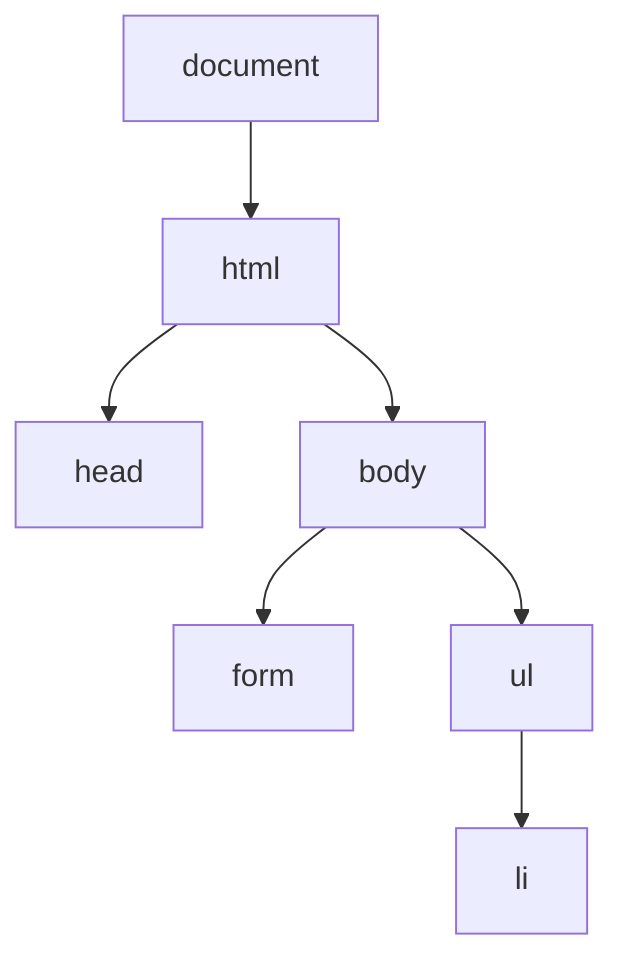
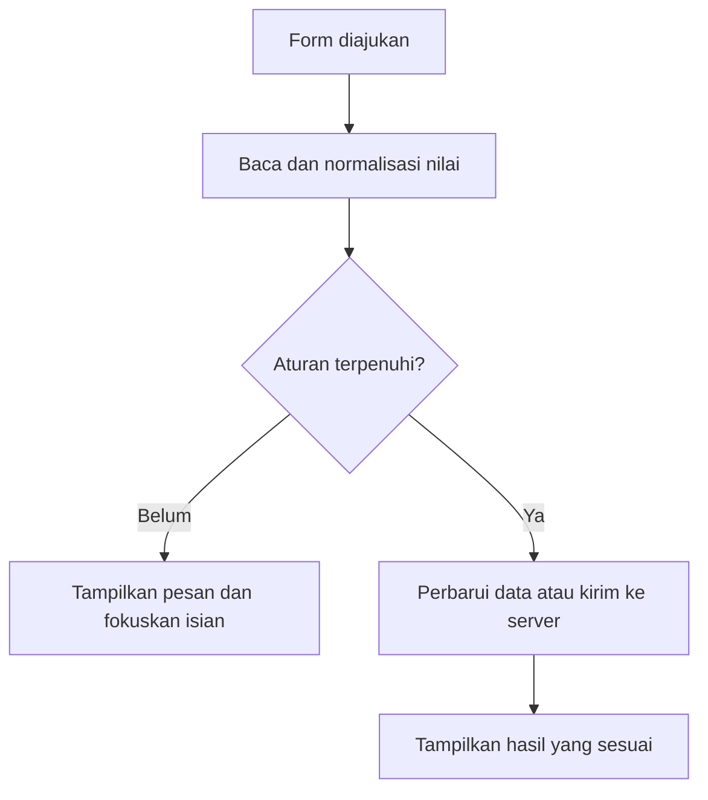

# Belajar JavaScript untuk Web — Dasar, DOM, Event, Validasi Form, dan Client-Side

> Panduan belajar bertahap berbahasa Indonesia, dengan contoh, hasil yang diharapkan, alasan, percobaan, proyek lengkap, dan latihan beserta pembahasan.
>
> Tujuan kita: kamu mampu **membaca dan menjelaskan kode JavaScript, menghubungkannya dengan HTML/CSS, mengelola interaksi serta data di browser, lalu menemukan penyebab ketika hasilnya keliru**.

Pada panduan CSS, kita mengatur bagaimana elemen ditampilkan. Sekarang kita belajar bagaimana halaman merespons: membaca isian, memeriksa nilai, menambah elemen, mengubah status, dan menyimpan data. Pengetahuan CSS-mu tetap dipakai untuk menampilkan state seperti aktif, error, selesai, dan loading.

Kita memakai JavaScript biasa, tanpa framework dan tanpa proses build. Beberapa konsep lanjut diperkenalkan sebagai peta belajar; kamu tidak perlu menggunakan semuanya sekaligus. Materi dan rujukan diperiksa pada **19 Oktober 2026**. Referensi primer tersedia di [Bab 41](#bab-41).

## Daftar isi

| Dasar bahasa | DOM, event, dan form | Client-side dan penerapan |
| --- | --- | --- |
| [00. Cara belajar](#bab-00) | [14. DOM dan model perubahan](#bab-14) | [28. Web Storage](#bab-28) |
| [01. JavaScript dalam web](#bab-01) | [15. Memilih elemen](#bab-15) | [29. Origin dan siklus data](#bab-29) |
| [02. Mulai menjalankan kode](#bab-02) | [16. Mengubah elemen](#bab-16) | [30. Asynchronous JavaScript](#bab-30) |
| [03. Variabel](#bab-03) | [17. Membuat dan menghapus elemen](#bab-17) | [31. Fetch dan HTTP](#bab-31) |
| [04. Tipe data](#bab-04) | [18. Membaca input dan FormData](#bab-18) | [32. State antarmuka async](#bab-32) |
| [05. Operator dan konversi](#bab-05) | [19. Event handling](#bab-19) | [33. Modules dan struktur kode](#bab-33) |
| [06. Percabangan](#bab-06) | [20. Propagation dan delegation](#bab-20) | [34. Batas keamanan client-side](#bab-34) |
| [07. Perulangan](#bab-07) | [21. Pola event yang rapi](#bab-21) | [35. Aksesibilitas dan performa](#bab-35) |
| [08. Fungsi](#bab-08) | [22. Validasi HTML native](#bab-22) | [36. Debugging dan pengujian](#bab-36) |
| [09. Scope, closure, dan this](#bab-09) | [23. Constraint Validation API](#bab-23) | [37. Proyek lengkap](#bab-37) |
| [10. Array](#bab-10) | [24. Strategi validasi form](#bab-24) | [38. Latihan dan pembahasan](#bab-38) |
| [11. Object dan referensi](#bab-11) | [25. State dan CRUD](#bab-25) | [39. Rencana belajar](#bab-39) |
| [12. String, angka, tanggal, regex](#bab-12) | [26. Client dan server](#bab-26) | [40. Checklist dan resep cepat](#bab-40) |
| [13. Error dan debugging dasar](#bab-13) | [27. JSON](#bab-27) | [41. Glosarium dan rujukan](#bab-41) |

<a id="bab-00"></a>
## 00. Cara menggunakan panduan ini

### Urutan yang kusarankan

1. Bab 01–13: bahasa JavaScript. Latih membaca nilai, kondisi, dan alur fungsi.
2. Bab 14–21: hubungkan bahasa dengan halaman melalui DOM dan event.
3. Bab 22–25: bangun form yang dapat memberi umpan balik dan mengubah state.
4. Bab 26–35: pahami data client-side, penyimpanan, async, jaringan, serta batasnya.
5. Bab 36–41: bedah proyek, kerjakan latihan, dan evaluasi dengan kasus nyata.

Gunakan siklus **prediksi → jalankan → amati → jelaskan → ubah satu hal**. Jangan buru-buru menambah fitur sebelum kamu bisa menerangkan alur fitur yang sudah ada.

### Bentuk pemahaman yang kita cari

Untuk tombol “Tambah”, kamu seharusnya mampu menjelaskan: event apa yang didengar, elemen mana yang dibaca, tipe nilainya, aturan validasinya, data apa yang berubah, dan elemen apa yang diperbarui.

Mengetahui arti satu baris belum cukup jika kamu belum dapat mengikuti hubungan antarbaris. Karena itu contoh kecil akan berkembang menjadi satu aplikasi.

### Konvensi contoh

- Blok `javascript` adalah kode JS; blok `html` adalah struktur; blok `css` adalah presentasi.
- Komentar `// Hasil:` menjelaskan hasil yang diharapkan.
- Potongan konsep berdiri sendiri kecuali disebutkan berlanjut. Jangan menggabungkan semua potongan ke satu file.
- Potongan DOM memerlukan elemen HTML yang disebutkan.
- Contoh yang membutuhkan server lokal dijelaskan secara khusus.
- Contoh error disengaja diberi penjelasan; jangan menilainya sebagai kode yang harus dipakai apa adanya.

### Isi paket praktik

| Lokasi | Kegunaan |
| --- | --- |
| `README.md` | Panduan lengkap ini, termasuk kode proyek |
| `index.html` | Daftar tautan ke seluruh praktik |
| `assets/lab.css` | Gaya bersama halaman latihan |
| `latihan/01-dasar/` | Operator, fungsi, dan array |
| `latihan/02-dom/` | Membuat, menyorot, dan menghapus catatan |
| `latihan/03-event/` | Urutan event dan perilaku default |
| `latihan/04-validasi/` | Pesan error dan pemeriksaan form |
| `latihan/05-storage/` | Membandingkan tiga umur state |
| `latihan/06-fetch/` | Loading, data, kosong, dan kegagalan request |
| `proyek/` | Aplikasi Ruang Belajar dengan CRUD dan penyimpanan browser |

<a id="bab-01"></a>
## 01. Apa peran JavaScript di web?

| Bagian | Peran | Contoh pada daftar belajar |
| --- | --- | --- |
| HTML | Struktur dan makna | Form, daftar, label, tombol |
| CSS | Tampilan | Susunan kartu, jarak, warna selesai |
| JavaScript | Logika dan respons | Memeriksa input, menambah rencana, menghitung progres |

JavaScript dan Java adalah bahasa berbeda. Jika kamu pernah memakai array atau enhanced for di Java, sebagian ide akan terasa akrab, tetapi aturan tipe, object, fungsi, dan lingkungannya berbeda.

### Bahasa dan lingkungan

`const`, `if`, fungsi, array, dan object adalah bagian bahasa. `document`, DOM, event browser, `fetch`, dan `localStorage` berasal dari API lingkungan web. Karena itu kode perhitungan dapat berjalan di beberapa runtime, sedangkan `document.querySelector()` memerlukan lingkungan dengan DOM.

JavaScript juga dapat berjalan pada server melalui runtime yang sesuai. Dalam panduan ini, fokus kita adalah **JavaScript di browser**.

### Alur interaksi sederhana

Pengguna menekan tombol → browser mengirim event → callback berjalan → program membaca nilai → state diperbarui → DOM menampilkan hasil.

Contoh nyatanya: ketika kamu menulis komentar, teks dalam input belum otomatis menjadi item daftar. JavaScript perlu membaca input, membentuk data, dan menampilkan item tersebut.

### Client-side mempunyai batas kepercayaan

Kode yang dikirim ke browser dapat diperiksa dan diubah oleh pengguna. Kamu dapat memakai client-side untuk pengalaman interaksi yang cepat, tetapi keputusan seperti otorisasi akun, harga yang sah, atau izin mengakses data perlu diverifikasi oleh sistem yang dipercaya di sisi server.

Kita akan menerapkan perbedaan ini pada form dan penyimpanan, bukan menganggap halaman yang terlihat benar otomatis membuktikan datanya benar.

<a id="bab-02"></a>
## 02. Mulai menjalankan JavaScript

### Cara pertama: Console

Buka DevTools browser, pilih Console, lalu coba:

```javascript
const nama = "Ahong";
console.log(`Halo, ${nama}!`);
// Hasil: Halo, Ahong!
```

Console berguna untuk percobaan singkat. Untuk latihan yang berulang, gunakan file agar perubahan dapat disimpan dan diperiksa. Pada sebagian konteks console/file, deklarasi ulang `const` dengan nama yang sama dapat menimbulkan masalah; gunakan nama berbeda, block tersendiri, atau muat ulang konteks latihan sesuai kebutuhan.

### Cara kedua: file HTML dan JavaScript

Buat dua file pada folder yang sama.

**`index.html`:**

```html
<!doctype html>
<html lang="id">
<head>
  <meta charset="utf-8">
  <meta name="viewport" content="width=device-width, initial-scale=1">
  <title>Penghitung pertamaku</title>
  <script src="app.js" defer></script>
</head>
<body>
  <h1>Jumlah percobaan</h1>
  <p id="jumlah" role="status">0</p>
  <button id="tambah" type="button">Tambah satu</button>
</body>
</html>
```

**`app.js`:**

```javascript
"use strict";

let jumlah = 0;
const tampilan = document.querySelector("#jumlah");
const tombol = document.querySelector("#tambah");

tombol.addEventListener("click", () => {
  jumlah += 1;
  tampilan.textContent = jumlah;
});
```

**Hasil:** angka bertambah setiap tombol diaktifkan. Saat halaman dimuat ulang, angka kembali nol karena belum disimpan ke penyimpanan persisten.

### Mengapa memakai `defer`?

Pada external classic script, defer memungkinkan HTML terus diparse saat script diambil. Script dijalankan sesudah dokumen selesai diparse, sebelum DOMContentLoaded; beberapa defer script mempertahankan urutan dokumennya. Akibatnya, elemen yang dipilih sudah tersedia pada contoh ini.

| Bentuk | Perilaku penting |
| --- | --- |
| Classic script tanpa async/defer | Pada posisi parser-inserted biasa, dapat menahan parsing saat diambil/dijalankan |
| External classic script dengan defer | Menunggu parsing selesai; urutan antar-defer script dipertahankan |
| External script dengan async | Berjalan ketika siap; jangan mengandalkan urutan seperti defer |
| `type="module"` | Memiliki scope modul dan secara default menunggu parsing seperti deferred; aturan impor dan pemuatan berbeda |

Defer tidak membuat inline classic script menjadi deferred hanya karena atributnya ditambahkan. Untuk modul, pelajari Bab 33 dan gunakan server lokal.

### Kapan membutuhkan localhost?

Banyak contoh DOM sederhana dapat dibuka sebagai file. Untuk Fetch, modules, dan pengujian origin/penyimpanan yang konsisten, gunakan server HTTP lokal.

Jika Python tersedia, dari folder `belajar-javascript` jalankan:

```bash
python3 -m http.server 8000 --bind 127.0.0.1
```

Pada lingkungan yang memakai perintah `python`, sesuaikan namanya. Buka `http://localhost:8000/`. Kamu juga boleh menggunakan server lokal dari editor yang sudah kamu gunakan. Hentikan server terminal dengan Ctrl+C setelah selesai.

Jalankan terminal pada folder paket contoh agar file yang disajikan terbatas pada latihan. Gunakan alamat yang sama setiap kali menguji storage; `localhost` dan `127.0.0.1` merupakan host berbeda.

<a id="bab-03"></a>
## 03. Variabel: memberi nama pada nilai

Variabel memberi nama agar nilai dapat dipakai kembali. Hubungan nama dengan nilai disebut binding; bedakan mengganti binding dengan mengubah isi object yang dirujuknya.

```javascript
const nama = "Ahong";
let jumlahLatihan = 0;

jumlahLatihan = jumlahLatihan + 1;
console.log(nama, jumlahLatihan);
// Hasil: Ahong 1
```

`const` digunakan ketika binding-nya tidak akan diberi nilai baru. `let` digunakan ketika kamu memang perlu reassign. Mulai dari const, lalu pilih let ketika kebutuhan perubahan binding jelas.

### Deklarasi, inisialisasi, dan assignment

```javascript
let skor;       // deklarasi; nilainya undefined
skor = 80;      // assignment
let batas = 75; // deklarasi sekaligus inisialisasi
```

`=` berarti memberi nilai, bukan memeriksa kesamaan. Pemeriksaan kesamaan akan kita lakukan dengan `===`.

### `const` bukan berarti isi object menjadi beku

```javascript
const siswa = { nama: "Ahong", selesai: false };
siswa.selesai = true; // boleh: object yang dirujuk tetap sama

// siswa = { nama: "Ayu" }; // TypeError jika dijalankan: binding diganti
```

Hal serupa berlaku untuk array: array const masih dapat dipush atau diubah elemennya. Kita memisahkan perubahan binding dan perubahan isi object.

### Penamaan

Gunakan nama yang menjelaskan peran: `jumlahKomentar`, `inputEmail`, `daftarTugas`, `isLoading`. Nama `x` bisa masuk akal dalam rumus kecil, tetapi kurang membantu untuk state form.

JavaScript case-sensitive: `nama` dan `Nama` berbeda. Nama tidak boleh dimulai dengan digit atau memakai keyword bahasa pada posisi yang dilarang.

### Bagaimana dengan `var`?

Var masih ada dalam bahasa dan sering muncul pada kode lama. Ia memiliki aturan scope dan hoisting berbeda dari let/const. Untuk contoh baru di panduan ini kita memakai let/const agar scope block lebih mudah diikuti. Mengenali var tetap berguna saat membaca kode yang sudah ada.

**Coba sendiri:** buat `const daftar = []`, lakukan `daftar.push("DOM")`, lalu jelaskan mengapa itu tidak melanggar const.

<a id="bab-04"></a>
## 04. Tipe data dan cara memeriksanya

### Primitive dan object

| Tipe | Contoh | Kegunaan |
| --- | --- | --- |
| `string` | `"Belajar DOM"` | Teks |
| `number` | `30`, `3.5`, `NaN` | Angka biasa |
| `boolean` | `true`, `false` | Keadaan dua nilai |
| `undefined` | Variabel tanpa nilai awal; property yang tidak ada | Tidak ada nilai yang tersedia pada konteks itu |
| `null` | `null` | Ketiadaan yang ditentukan secara eksplisit |
| `bigint` | `123n` | Bilangan bulat presisi arbitrer |
| `symbol` | `Symbol("id")` | Identitas/key unik dalam penggunaan tertentu |
| `object` | `{ nama: "Ayu" }`, `[1, 2]` | Kumpulan property atau struktur lain |

Tujuh pertama adalah primitive. Array dan fungsi merupakan object dalam model bahasa, meskipun typeof mempunyai hasil khusus untuk fungsi. Untuk web dasar, kamu paling sering memakai string, number, boolean, null/undefined, array, dan object biasa.

```javascript
console.log(typeof "30");       // "string"
console.log(typeof 30);         // "number"
console.log(typeof true);       // "boolean"
console.log(typeof undefined);  // "undefined"
console.log(typeof null);       // "object" — kekhususan historis typeof
console.log(typeof []);         // "object"
console.log(Array.isArray([])); // true
console.log(typeof (() => 1));  // "function"
```

### `NaN`

NaN adalah nilai number yang mewakili hasil numerik yang tidak valid pada operasi tertentu.

```javascript
const angka = Number("halo");
console.log(angka);                 // NaN
console.log(Number.isNaN(angka));   // true
console.log(angka === NaN);         // false
console.log(Number.isFinite(angka)); // false
```

Gunakan pemeriksaan yang sesuai. Number.isFinite membantu menolak NaN serta Infinity/-Infinity; Number.isInteger memeriksa bilangan bulat. Keduanya tidak menggantikan aturan domain seperti minimal 5 menit atau maksimal 240 menit.

### Null dan undefined pada DOM/data

`querySelector` mengembalikan null bila tidak menemukan elemen. Property object yang tidak tersedia biasanya menghasilkan undefined. Jangan langsung membaca `.value` dari hasil pemilihan tanpa memastikan elemen memang ada pada struktur halamanmu.

### JavaScript dinamis bukan tanpa aturan

Binding let dapat menerima tipe berbeda dari waktu ke waktu, tetapi operasi tetap memiliki aturan tipe. Jika variabel `jumlah` kadang number dan kadang string, hasil penjumlahan dapat berubah. Jaga arti variabel tetap konsisten agar kode mudah ditelusuri.

<a id="bab-05"></a>
## 05. Operator, konversi, truthy, dan falsy

### Operator aritmetika

| Operator | Makna | Contoh |
| --- | --- | --- |
| `+` | Penjumlahan atau penyusunan string | `5 + 2` menjadi 7 |
| `-`, `*`, `/` | Kurang, kali, bagi | `10 / 4` menjadi 2.5 |
| `%` | Remainder/sisa pembagian | `17 % 5` menjadi 2 |
| `**` | Perpangkatan | `2 ** 3` menjadi 8 |
| `+=` | Assignment dengan penambahan | `jumlah += 1` |

### Mengapa angka dari input malah digabung?

```javascript
const a = "10";
const b = "5";
console.log(a + b);                 // "105"
console.log(Number(a) + Number(b)); // 15
```

`.value` pada input teks maupun number adalah string. Gunakan konversi dengan sengaja, bukan berharap browser mengetahui maksud perhitunganmu.

```javascript
console.log(Number(""));      // 0
console.log(Number("   "));   // 0
console.log(Number("12abc")); // NaN
console.log(parseInt("12abc", 10)); // 12
```

Karena itu, untuk validasi angka: periksa kosong, konversi, periksa tipe/rentang/step. ParseInt dapat berguna untuk parsing tertentu, tetapi bukan pemeriksaan ketat bahwa seluruh string adalah angka yang sah.

### Perbandingan

```javascript
console.log(5 === "5"); // false
console.log(5 == "5");  // true, ada konversi menurut aturan abstract equality
console.log(5 !== 3);   // true
console.log(80 >= 75);  // true
```

Gunakan `===` dan `!==` sebagai default ketika kamu mengharapkan tipe dan nilai yang sesuai. Tetap lakukan konversi eksplisit jika data masukan memang string.

### Truthy dan falsy

Kasus falsy yang umum: false, 0, -0, 0n, NaN, string kosong, null, dan undefined. Banyak nilai lain truthy, termasuk string `"false"`, string `"0"`, array kosong, dan object kosong.

```javascript
console.log(Boolean("false")); // true
console.log(Boolean([]));      // true
console.log(Boolean(0));       // false
```

Jangan memakai `if (!nilai)` jika angka nol merupakan masukan yang sah dan kamu hanya bermaksud memeriksa ketiadaan.

### Logika dan nilai fallback

```javascript
const nama = "";
console.log(nama || "Tanpa nama"); // "Tanpa nama"

const skor = 0;
console.log(skor || 100); // 100
console.log(skor ?? 100); // 0
```

`||` memakai nilai kanan jika kiri falsy. `??` hanya memakai kanan jika kiri null atau undefined. `&&` dan `||` mengembalikan operand yang dipilih, tidak selalu boolean.

```javascript
const bolehMasuk = true;
const kursiTersedia = false;
console.log(bolehMasuk && kursiTersedia); // false
console.log(!kursiTersedia);              // true
```

Gunakan tanda kurung saat ekspresi mulai sulit dibaca. Operator `??` juga tidak boleh langsung dicampur dengan `&&`/`||` tanpa pengelompokan yang diperlukan sintaks.

<a id="bab-06"></a>
## 06. Percabangan: memilih langkah berdasarkan kondisi

```javascript
const nilai = 82;

if (nilai >= 85) {
  console.log("Sangat baik");
} else if (nilai >= 75) {
  console.log("Lulus");
} else {
  console.log("Perlu latihan lagi");
}
// Hasil: Lulus
```

Urutan pemeriksaan penting. Jika `nilai >= 75` diperiksa terlebih dahulu, nilai 90 sudah masuk cabang itu sehingga cabang berikutnya tidak dijalankan pada rangkaian if/else tersebut.

### Early return

```javascript
function hitungRataRata(daftar) {
  if (daftar.length === 0) return null;
  const total = daftar.reduce((jumlah, nilai) => jumlah + nilai, 0);
  return total / daftar.length;
}
```

Kasus yang menghentikan proses ditangani di awal. Fungsi utama menjadi lebih mudah diikuti daripada membungkus seluruh isi dalam banyak if bertingkat.

### Ternary untuk pilihan nilai sederhana

```javascript
const selesai = true;
const label = selesai ? "Selesai" : "Belum selesai";
console.log(label); // "Selesai"
```

Gunakan if/else jika setiap cabang memuat beberapa langkah. Ternary bersarang panjang biasanya sulit dibaca pemula.

### Switch

```javascript
const aksi = "hapus";
switch (aksi) {
  case "tambah":
    console.log("Menambah item");
    break;
  case "hapus":
    console.log("Menghapus item");
    break;
  default:
    console.log("Aksi tidak dikenal");
}
```

Tanpa break atau penghentian lain, eksekusi dapat berlanjut ke case sesudahnya. Fall-through bisa disengaja, tetapi harus jelas maksudnya.

<a id="bab-07"></a>
## 07. Perulangan: mengerjakan langkah untuk banyak nilai

### For biasa ketika kamu membutuhkan indeks

```javascript
const nilai = [70, 80, 90];
for (let i = 0; i < nilai.length; i += 1) {
  console.log(i, nilai[i]);
}
// Pasangan: 0 70; 1 80; 2 90
```

Indeks dimulai dari nol. Kondisi `i < nilai.length` berhenti sebelum indeks di luar array.

### For...of ketika yang dibutuhkan nilainya

```javascript
const nilai = [70, 80, 90];
let total = 0;
for (const angka of nilai) {
  total += angka;
}
console.log(total); // 240
```

Ini dapat kamu hubungkan dengan ide enhanced for di Java: mengambil nilai satu per satu. For...of bekerja pada iterable, termasuk array, tetapi tidak langsung mengiterasi plain object dengan cara yang sama.

### While dan do...while

```javascript
let sisa = 3;
while (sisa > 0) {
  console.log(sisa);
  sisa -= 1;
}
// 3, 2, 1

let percobaan = 0;
do {
  percobaan += 1;
} while (percobaan < 1);
console.log(percobaan); // 1
```

While memeriksa kondisi sebelum badan loop; do...while menjalankan badan setidaknya sekali. Pastikan ada perubahan yang memungkinkan loop berhenti.

### Break dan continue

```javascript
for (const nilai of [40, 80, 90, 100]) {
  if (nilai < 75) continue; // lewati iterasi ini
  if (nilai === 100) break; // hentikan loop
  console.log(nilai);
}
// 80, 90
```

### For...in bukan pilihan utama untuk nilai array

For...in mengunjungi key enumerable, termasuk yang dapat diwariskan. Untuk nilai array, gunakan for...of atau method array yang sesuai. Untuk property milik plain object, Object.keys/values/entries sering lebih jelas.

### Jangan membuat loop berat menahan halaman

Loop sinkron yang sangat lama dapat menahan respons UI pada main thread. Membungkusnya dalam fungsi async tidak otomatis memindahkannya ke thread lain. Kita bahas model async pada Bab 30.

<a id="bab-08"></a>
## 08. Fungsi: langkah bernama dengan input dan hasil

```javascript
function hitungTotal(harga, jumlah) {
  return harga * jumlah;
}

const total = hitungTotal(12000, 3);
console.log(total); // 36000
```

`harga` dan `jumlah` adalah parameter. `12000` dan `3` adalah argumen pada pemanggilan. `return` mengembalikan nilai dan mengakhiri pemanggilan fungsi itu.

### Return berbeda dari console.log

```javascript
function tampilkanJumlah(a, b) {
  console.log(a + b);
}

const hasil = tampilkanJumlah(2, 3); // Console menampilkan 5
console.log(hasil);                 // undefined
```

Mencetak nilai tidak mengembalikannya ke pemanggil. Fungsi tanpa return nilai menghasilkan undefined. Untuk fungsi hitung yang hasilnya akan dipakai lagi, return lebih tepat.

### Declaration, expression, dan arrow

```javascript
function tambah(a, b) { return a + b; }
const kurang = function (a, b) { return a - b; };
const kali = (a, b) => a * b;
```

Ketiganya dapat dipanggil, tetapi aturan hoisting dan this tidak sama. Arrow bukan sekadar singkatan yang selalu dapat menggantikan semua fungsi.

```javascript
const buatSiswa = nama => ({ nama, aktif: true });
```

Tanda kurung membuat object literal dibaca sebagai nilai yang dikembalikan. Jika arrow memakai badan `{ ... }`, gunakan return eksplisit ketika kamu ingin mengembalikan nilai.

### Default parameter

```javascript
function sapa(nama = "Teman") {
  return `Halo, ${nama}!`;
}
console.log(sapa());      // "Halo, Teman!"
console.log(sapa("Ayu")); // "Halo, Ayu!"
```

Default dipakai ketika argumen tidak diberikan atau nilainya undefined; null tidak otomatis diganti oleh default parameter.

### Callback

```javascript
const nilai = [70, 80, 90];
const nilaiBaru = nilai.map(angka => angka + 5);
console.log(nilaiBaru); // [75, 85, 95]
```

Fungsi `angka => angka + 5` diserahkan kepada map untuk dipanggil sesuai mekanismenya. Callback tidak selalu asynchronous; callback map berjalan sinkron.

### Fungsi dengan satu tanggung jawab

Pisahkan fungsi membaca input, memvalidasi, mengubah data, dan menampilkan data. Fungsi kecil yang menerima nilai lalu mengembalikan hasil lebih mudah diperiksa daripada satu callback sangat panjang yang mengerjakan semuanya.

**Coba sendiri:** buat `hitungMenit(jam)` yang mengembalikan jam dikali 60. Panggil dengan 1.5 dan jelaskan dari mana hasil 90 berasal.

<a id="bab-09"></a>
## 09. Scope, hoisting, closure, dan `this`

### Scope: di mana sebuah nama bisa dipakai?

```javascript
const namaAplikasi = "Ruang Belajar";

function cetakRingkasan() {
  const jumlah = 3;
  if (jumlah > 0) {
    const pesan = "Ada rencana";
    console.log(namaAplikasi, jumlah, pesan);
  }
  // console.log(pesan); // ReferenceError jika dibuka: di luar block-nya
}
cetakRingkasan();
```

Let dan const mempunyai block scope. Fungsi dapat mengakses binding dari scope luar yang sesuai, tetapi scope luar tidak otomatis dapat membaca variabel lokal di dalam fungsi.

### Hoisting dan temporal dead zone

Hoisting bukan berarti semua deklarasi dapat dipakai bebas sebelum barisnya. Function declaration biasa dapat dipanggil sebelum deklarasinya dalam scope yang sesuai. Let/const mempunyai temporal dead zone sampai deklarasinya dieksekusi.

```javascript
console.log(tambah(2, 3)); // 5
function tambah(a, b) { return a + b; }

// console.log(skor); // ReferenceError jika dijalankan pada posisi ini
let skor = 80;
```

Var mempunyai perilaku berbeda: binding diinisialisasi undefined pada tahap awal scope-nya, sedangkan assignment tetap terjadi saat alur mencapai baris assignment. Jangan memakai istilah “semua variabel dinaikkan” sebagai alasan untuk mengabaikan urutan inisialisasi.

### Closure: fungsi mempertahankan akses ke lingkungan leksikalnya

```javascript
function buatPenghitung() {
  let jumlah = 0;
  return function tambah() {
    jumlah += 1;
    return jumlah;
  };
}

const penghitungA = buatPenghitung();
const penghitungB = buatPenghitung();
console.log(penghitungA()); // 1
console.log(penghitungA()); // 2
console.log(penghitungB()); // 1
```

Setiap pemanggilan buatPenghitung membentuk lingkungan yang berbeda. Fungsi hasilnya tetap mengakses jumlah dari lingkungannya sendiri. Closure berguna pada callback event, pengelolaan state kecil, dan factory; bukan mekanisme untuk menyimpan rahasia yang tidak boleh diketahui pengguna browser.

### `this` bergantung cara fungsi dipanggil

```javascript
const siswa = {
  nama: "Ayu",
  sapa() {
    return `Halo, ${this.nama}`;
  }
};
console.log(siswa.sapa()); // "Halo, Ayu"
```

Pada pemanggilan method ini, this merujuk siswa. Jika method dilepas menjadi fungsi lain dan dipanggil sendiri, konteksnya tidak otomatis tetap siswa.

| Cara | Aturan dasar |
| --- | --- |
| Ordinary function dipanggil sendiri dalam strict mode | This bernilai undefined |
| `obj.method()` pada ordinary method | This ditentukan oleh object penerima pemanggilan |
| Arrow function | Tidak membuat this sendiri; memakai this dari lingkungan leksikal |
| `new Konstruktor()` | This merujuk object baru sesuai mekanisme konstruktor |
| `call`, `apply`, `bind` | Dapat menentukan this ordinary function secara eksplisit |

Untuk event di panduan ini, kita lebih sering memakai `event.currentTarget` atau referensi elemen bernama agar maksud kode jelas. Jangan mengganti method yang memakai this menjadi arrow tanpa memahami akibatnya.

### Strict mode

`"use strict";` pada awal classic script/fungsi mengaktifkan aturan yang lebih ketat, misalnya assignment ke nama yang tidak dideklarasikan menjadi error. Modules berada dalam strict mode secara otomatis. Strict mode membantu mendeteksi kesalahan tertentu; ia tidak memvalidasi seluruh logika aplikasi.

<a id="bab-10"></a>
## 10. Array: menyimpan dan mengolah kumpulan data

```javascript
const materi = ["HTML", "CSS", "JavaScript"];
console.log(materi[0]);     // "HTML"
console.log(materi.length); // 3
```

Array JavaScript bisa berisi campuran tipe, tetapi untuk daftar aplikasi biasanya lebih mudah menjaga bentuk elemen konsisten, misalnya seluruhnya object tugas.

### Operasi yang mengubah array

```javascript
const materi = ["HTML", "CSS"];
materi.push("DOM");       // tambah di akhir
const terakhir = materi.pop(); // ambil dan hapus akhir
materi.unshift("Dasar");  // tambah di awal
console.log(materi);      // ["Dasar", "HTML", "CSS"]
console.log(terakhir);    // "DOM"
```

Splice dapat menghapus/menyisipkan pada indeks dan mengubah array asal. Slice mengambil bagian menjadi array baru tanpa menghapus bagian asal.

### Pilih method sesuai pertanyaan

| Kebutuhan | Method | Hasil |
| --- | --- | --- |
| Melakukan efek untuk setiap elemen | `forEach` | Undefined; tidak mengumpulkan hasil callback |
| Mengubah tiap elemen menjadi nilai baru | `map` | Array baru |
| Mengambil semua yang cocok | `filter` | Array baru |
| Mengambil satu yang pertama cocok | `find` | Elemen atau undefined |
| Mencari indeks yang pertama cocok | `findIndex` | Indeks atau -1 |
| Ada setidaknya satu yang cocok? | `some` | Boolean |
| Semua cocok? | `every` | Boolean |
| Mengakumulasi menjadi satu hasil | `reduce` | Nilai akumulasi |
| Menguji keberadaan nilai | `includes` | Boolean |

```javascript
const tugas = [
  { id: "a", judul: "CSS", menit: 30, selesai: true },
  { id: "b", judul: "DOM", menit: 45, selesai: false }
];

console.log(tugas.map(item => item.judul)); // ["CSS", "DOM"]
console.log(tugas.filter(item => !item.selesai).length); // 1
console.log(tugas.find(item => item.id === "b").judul); // "DOM"
console.log(tugas.some(item => item.selesai)); // true
console.log(tugas.every(item => item.selesai)); // false
console.log(tugas.reduce((total, item) => total + item.menit, 0)); // 75
```

Berikan initial value pada reduce ketika itu sesuai, seperti 0 untuk penjumlahan. Ini juga membuat kasus array kosong lebih mudah ditangani.

### `find` bisa tidak menemukan apa pun

```javascript
const tugas = [{ id: "a", judul: "CSS" }];
const ditemukan = tugas.find(item => item.id === "z");
console.log(ditemukan?.judul ?? "Tidak ditemukan"); // "Tidak ditemukan"
```

Jangan memakai optional chaining untuk menutupi semua keadaan yang seharusnya mustahil. Jika elemen penting aplikasi hilang karena ID salah, perbaiki penyebabnya.

### Sorting

```javascript
const angka = [2, 10, 3];
console.log([...angka].sort());             // [10, 2, 3], perbandingan string default
console.log([...angka].sort((a, b) => a - b)); // [2, 3, 10]
console.log(angka);                         // [2, 10, 3]
```

Sort mengubah array yang dipanggil. Spread sebelum sort membuat array luar baru. Ini tidak berarti object bersarangnya ikut disalin mendalam. Beberapa API array baru menyediakan alternatif yang tidak memutasi; periksa dukungan target saat menggunakannya.

### Dua kekeliruan yang sering terjadi

```javascript
const hasil = [1, 2, 3].forEach(angka => angka * 2);
console.log(hasil); // undefined, bukan [2, 4, 6]

const daftar = ["a", "b"];
console.log(daftar.indexOf("z")); // -1
```

Jangan menguji hasil indexOf hanya dengan `if (indeks)`: nol falsy padahal valid, -1 truthy padahal tidak ditemukan. Bandingkan dengan -1 atau gunakan includes.

<a id="bab-11"></a>
## 11. Object, referensi, destructuring, dan spread

Object menyimpan property bernama. Untuk satu rencana belajar, property lebih mudah dibaca daripada array posisi tanpa nama.

```javascript
const tugas = {
  id: "tugas-1",
  judul: "Belajar DOM",
  menit: 30,
  selesai: false
};
console.log(tugas.judul);     // "Belajar DOM"
console.log(tugas["menit"]); // 30
```

Bracket notation berguna ketika nama property berasal dari variabel:

```javascript
const siswa = { nama: "Ayu", nilai: 90 };
const kolom = "nilai";
console.log(siswa[kolom]); // 90
```

### Assignment object tidak menggandakan isinya

```javascript
const a = { selesai: false };
const b = a;
b.selesai = true;
console.log(a.selesai); // true
console.log(a === b);  // true
```

Kedua binding menyimpan nilai referensi ke object yang sama. JavaScript meneruskan argumen sebagai nilai; untuk object, nilai yang disalin adalah referensinya. Mengubah property melalui referensi itu dapat terlihat di luar fungsi. Mengganti binding parameter menjadi object lain tidak otomatis mengganti binding pemanggil.

### Membentuk object baru dengan spread

```javascript
const awal = { id: "a", selesai: false };
const baru = { ...awal, selesai: true };
console.log(awal.selesai); // false
console.log(baru.selesai); // true
```

Property yang ditulis belakangan dapat menimpa property sebelumnya. Pola ini akan kita gunakan saat memperbarui satu item state.

### Spread adalah shallow copy

```javascript
const awal = { profil: { nama: "Ayu" } };
const salinan = { ...awal };
salinan.profil.nama = "Budi";
console.log(awal.profil.nama); // "Budi"
```

Object profil masih sama. Untuk perubahan bersarang, bentuk object baru pada tingkat yang berubah atau gunakan strategi penyalinan yang sesuai tipe data. StructuredClone dapat membantu untuk data yang mendukungnya, tetapi bukan penyalin universal untuk fungsi dan semua jenis object.

### Destructuring

```javascript
const tugas = { judul: "Belajar DOM", menit: 30 };
const { judul, menit } = tugas;
const [pertama, kedua] = [10, 20];
console.log(judul, menit, pertama, kedua);
// "Belajar DOM" 30 10 20
```

Gunakan ketika membuat nama lokal terasa lebih jelas. Jika mengganti banyak nama sekaligus membuat asal nilainya sulit dikenali, penulisan langsung `tugas.judul` mungkin lebih mudah dibaca.

### Memeriksa property dan nilai bertingkat

```javascript
const siswa = { nama: "Ayu", nilai: 0 };
console.log(Object.hasOwn(siswa, "nilai")); // true
console.log(siswa.alamat?.kota ?? "Belum diisi"); // "Belum diisi"
```

Object.hasOwn memeriksa property milik object, bukan truthiness nilainya. Optional chaining menghentikan akses pada null/undefined pada bagian yang diberi operator tersebut.

### Set dan Map sebagai alat tambahan

```javascript
const idUnik = new Set(["a", "a", "b"]);
console.log(idUnik.size); // 2

const topik = new Map([["js", "JavaScript"]]);
topik.set("dom", "Document Object Model");
console.log(topik.get("js")); // "JavaScript"
```

Set menyimpan nilai unik menurut aturan kesetaraannya; object yang bentuknya sama tetapi identitasnya berbeda tidak otomatis dianggap satu. Map menyimpan pasangan key/value dan mendukung jenis key lebih luas daripada nama property string/symbol plain object. Pada proyek, Set dipakai untuk memeriksa apakah ID task terduplikasi.

### Class dan prototype, sebagai pengenalan

```javascript
class SesiBelajar {
  constructor(judul, menit) {
    this.judul = judul;
    this.menit = menit;
  }
  ringkasan() {
    return `${this.judul}: ${this.menit} menit`;
  }
}
console.log(new SesiBelajar("DOM", 30).ringkasan()); // "DOM: 30 menit"
```

Class memberi sintaks untuk pola object dengan constructor/method dan menggunakan model prototype JavaScript. Proyek kecil kita cukup memakai plain object dan fungsi. Pelajari prototype serta OOP lebih lanjut jika jenis masalahmu membutuhkannya.

<a id="bab-12"></a>
## 12. String, angka, tanggal, dan regex dalam pekerjaan web

### String yang sering kamu olah

```javascript
const judul = "  Belajar DOM  ";
console.log(judul.trim());                  // "Belajar DOM"
console.log(judul.trim().toLowerCase());    // "belajar dom"
console.log(judul.includes("DOM"));        // true
console.log("HTML,CSS,JS".split(","));     // ["HTML", "CSS", "JS"]
console.log(["HTML", "CSS"].join(" / ")); // "HTML / CSS"
```

String primitive tidak dimutasi oleh method seperti trim/toLowerCase; method itu menghasilkan nilai string baru. Includes peka huruf besar-kecil, sehingga pencarian sederhana biasanya menormalisasi kedua sisinya.

### Template literal

```javascript
const judul = "DOM";
const menit = 30;
console.log(`${judul} — ${menit} menit`); // "DOM — 30 menit"
```

Gunakan backtick untuk interpolasi `${...}`. Kutip biasa tidak menjalankan interpolasi tersebut.

### Panjang string dan Unicode

```javascript
console.log("Halo".length); // 4
console.log("😀".length);   // 2
```

Length string mengukur UTF-16 code units, bukan selalu jumlah karakter yang dirasakan manusia. Karena itu, batas “80 karakter” pada proyek memakai pengukuran length, sejalan dengan kebutuhan latihan yang dijelaskan. Untuk batas berdasarkan grapheme, gunakan segmentasi yang sesuai dan uji bahasa/emoji yang ditargetkan.

### Angka pecahan

```javascript
console.log(0.1 + 0.2 === 0.3); // false
console.log((0.1 + 0.2).toFixed(2)); // "0.30", string untuk tampilan
```

Number memakai representasi floating-point. Jangan menyimpulkan toFixed memperbaiki semua perhitungan; hasilnya string yang dibulatkan untuk penyajian. Untuk aturan numerik yang membutuhkan ketelitian tertentu, pilih representasi dan kebijakan pembulatan yang sesuai.

```javascript
const format = new Intl.NumberFormat("id-ID");
console.log(format.format(12500)); // "12.500" pada pemformatan locale ini
```

### Tanggal

```javascript
const waktu = new Date("2026-10-19T12:00:00Z");
console.log(waktu.toISOString()); // "2026-10-19T12:00:00.000Z"
```

Date menyatakan titik waktu; penyajian lokal dapat berbeda tergantung zona waktu. String dari input date berupa tanggal kalender seperti `2026-10-19`; jangan sembarang mengubahnya menjadi timestamp UTC lalu menampilkannya secara lokal jika kebutuhanmu sebenarnya hanya tanggal kalender. Pergeseran zona waktu dapat menghasilkan tanggal yang berbeda.

### Regex untuk pola yang jelas

```javascript
const polaKode = /^[A-Z]{3}-\d{3}$/;
console.log(polaKode.test("WEB-123")); // true
console.log(polaKode.test("WEB-12"));  // false
```

`^` awal input, `[A-Z]{3}` tiga huruf kapital ASCII, `-` literal, `\d{3}` tiga digit, `$` akhir input pada pola ini. Regex memeriksa pola, bukan memastikan suatu kode benar-benar terdaftar pada sistem.

Untuk email, mulai dari type=email dan aturan bisnis yang tepat. Regex raksasa yang kamu temukan tanpa memahami cakupannya sering lebih sulit dirawat daripada validasi berlapis yang jelas.

<a id="bab-13"></a>
## 13. Error dan debugging dasar

### Tiga masalah yang perlu dibedakan

| Jenis | Contoh | Langkah awal |
| --- | --- | --- |
| Syntax error | Kurung/kutip tidak seimbang | Baca file dan posisi yang dilaporkan parser |
| Runtime error | Membaca value dari null | Periksa nilai dan urutan eksekusi saat baris dijalankan |
| Logic error | Angka dijumlah sebagai string | Telusuri tipe serta nilai antara |

Runtime error yang tidak ditangani menghentikan eksekusi pada alur yang sedang berjalan, tetapi jangan menyederhanakannya menjadi “semua JavaScript di seluruh halaman selamanya berhenti”. Callback/pekerjaan lain mempunyai mekanisme eksekusinya sendiri.

### Baca pesan error pertama yang relevan

Jika Console mengatakan `Cannot read properties of null`, cari ekspresi yang nilainya null. Pada kode DOM, sering kali selector tidak menemukan elemen atau script berjalan sebelum elemen tersedia.

Jika `Identifier ... has already been declared`, periksa deklarasi ganda, scope, atau pemuatan script yang berulang. Jika `ReferenceError`, periksa ejaan dan jangkauan nama, bukan langsung menambah variabel global.

### Try/catch untuk kegagalan yang bisa ditangani

```javascript
const mentah = "bukan JSON";
try {
  const data = JSON.parse(mentah);
  console.log(data);
} catch (error) {
  console.log("Data tidak dapat dibaca:", error.name);
}
// Nama error: SyntaxError
```

Catch perlu melakukan sesuatu yang berguna: menampilkan pesan, memakai fallback yang sesuai, atau meneruskan error. Jangan menelan semua error dengan catch kosong karena penyebab kegagalan lalu sulit diketahui.

### Throw untuk menolak keadaan yang tidak sesuai

```javascript
function hitungDurasi(menit) {
  if (!Number.isFinite(menit) || menit < 0) {
    throw new Error("Durasi harus angka non-negatif yang finite.");
  }
  return menit * 60;
}
console.log(hitungDurasi(5)); // 300
```

Untuk isian pengguna yang umum salah, pesan validasi biasanya lebih tepat daripada exception sebagai alur biasa. Throw berguna untuk kontrak fungsi atau kegagalan yang memang perlu ditangani pemanggil.

### Teknik sederhana

```javascript
const nilai = "80";
console.log({ nilai, tipe: typeof nilai });
console.table([{ nama: "Ayu", nilai: 80 }, { nama: "Budi", nilai: 90 }]);
```

Gunakan breakpoint pada Sources/Debugger untuk menghentikan program dan melihat nilai lokal. Console.log membantu, tetapi breakpoint lebih kuat ketika urutan perubahan mulai sulit dilihat. Jangan mencetak data sensitif ke log aplikasi nyata.

**Latihan:** saat hasil total menjadi `"105"`, periksa typeof kedua masukan sebelum mengubah operator. Bukti nilai akan mengarahkan perbaikannya.

<a id="bab-14"></a>
## 14. DOM: dokumen yang dapat dibaca dan diubah

DOM, Document Object Model, merepresentasikan dokumen sebagai struktur node. JavaScript memakai API DOM untuk memilih, membuat, mengubah, atau menghapus bagian halaman.



Elemen seperti form atau li merupakan node, tetapi node tidak hanya elemen: teks dan komentar juga node. Ini menjelaskan perbedaan seperti children yang berisi elemen dan childNodes yang juga dapat berisi text node akibat spasi/baris baru.

### HTML sumber dan DOM saat ini

Jika JavaScript menambahkan li, struktur DOM berubah. File HTML pada disk tidak otomatis ditulis ulang. View Source dapat menunjukkan sumber awal, sedangkan panel Elements/Inspector menunjukkan struktur yang sedang berlaku.

### Pola perubahan yang kita pakai

1. Browser memunculkan event.
2. Callback membaca masukan.
3. Program memeriksa/menormalisasi masukan.
4. State berubah jika masukan diterima.
5. Fungsi render menyelaraskan tampilan dengan state.

Render bukan keyword khusus: itu nama yang lazim untuk fungsi pembentuk tampilan. Pada proyek kita, fungsi render membaca array tugas lalu membuat daftar elemen.

### Pisahkan data dan tampilannya

```javascript
const tugas = { judul: "Belajar DOM", selesai: false };
```

Object tersebut bukan elemen kartu. Ia data yang dapat ditampilkan sebagai kartu, baris tabel, atau ringkasan. Jika logika selalu membaca kembali teks dari kartu untuk mengetahui data sebenarnya, aplikasi mudah menjadi tidak konsisten saat tampilannya berubah.

Untuk demonstrasi DOM pertama, menghitung `daftar.children.length` cukup untuk menjelaskan struktur. Setelah masuk CRUD, jadikan state yang terstruktur sebagai sumber data dan DOM sebagai proyeksinya.

<a id="bab-15"></a>
## 15. Memilih dan menelusuri elemen

```html
<section id="materi">
  <h2 class="judul">Materi pilihan</h2>
  <button class="aksi" type="button">Mulai</button>
  <button class="aksi" type="button">Ulangi</button>
</section>
```

```javascript
const bagian = document.querySelector("#materi");
const judul = bagian.querySelector(".judul");
const semuaTombol = bagian.querySelectorAll(".aksi");
console.log(judul.textContent); // "Materi pilihan"
console.log(semuaTombol.length); // 2
```

Selector-nya memakai aturan CSS yang sudah kamu pelajari. Memilih dari bagian tertentu dapat membuat maksud pencarian lebih jelas daripada selalu mencari seluruh dokumen.

| API | Hasil |
| --- | --- |
| `document.getElementById("materi")` | Elemen ber-ID tersebut atau null; tanpa tanda # |
| `querySelector(".aksi")` | Elemen pertama yang cocok atau null |
| `querySelectorAll(".aksi")` | Static NodeList, bisa kosong |
| `element.closest(".kartu")` | Elemen itu sendiri atau ancestor terdekat yang cocok, atau null |
| `element.parentElement` | Induk elemen atau null |
| `element.children` | Live HTMLCollection anak elemen |
| `element.childNodes` | Koleksi node anak, termasuk text node |
| `nextElementSibling` | Saudara elemen berikutnya atau null |

### Static tidak sama dengan live

NodeList hasil querySelectorAll tidak otomatis bertambah ketika elemen baru ditambahkan kemudian. Children adalah koleksi live, sehingga isinya dapat berubah saat DOM berubah.

Jika perlu snapshot array:

```javascript
const tombol = [...document.querySelectorAll(".aksi")];
tombol.forEach(elemen => console.log(elemen.textContent));
```

NodeList mempunyai forEach pada browser modern, tetapi tidak memiliki semua method array. Spread/Array.from berguna ketika kamu memang memerlukan operasi array.

### Tangani hasil kosong sesuai maksudnya

```javascript
const banner = document.querySelector("#banner-opsional");
if (banner) {
  banner.hidden = true;
}
```

Jika banner memang opsional, pemeriksaan ini masuk akal. Jika tombol wajib hilang, jangan diam-diam mengabaikannya dengan optional chaining lalu membiarkan aplikasi setengah bekerja. Periksa ID, pemuatan script, dan struktur HTML-nya.

### Selector dari nilai dinamis

Jika kamu merangkai selector dari ID yang boleh berisi karakter khusus, gunakan escaping seperti CSS.escape pada bagian yang sesuai, atau hindari merangkai selector dengan menelusuri elemen/data yang sudah kamu miliki. Pada proyek, ID task dibandingkan sebagai string dataset sehingga tidak perlu dimasukkan ke selector mentah.

<a id="bab-16"></a>
## 16. Mengubah teks, class, atribut, dan property

### TextContent untuk teks

```html
<p id="status">Menunggu</p>
```

```javascript
const status = document.querySelector("#status");
status.textContent = "Latihan selesai.";
```

Setter textContent pada elemen mengganti seluruh anaknya dengan teks baru. Jika elemen mempunyai span/ikon di dalamnya yang ingin dipertahankan, targetkan bagian teks yang tepat, bukan mengganti seluruh wadah.

### `textContent`, `innerText`, dan `innerHTML`

| API | Maksud utama | Hal yang perlu diperhatikan |
| --- | --- | --- |
| `textContent` | Membaca/menulis teks node | Tidak memparse teks menjadi HTML |
| `innerText` | Teks dengan perhatian pada rendering | Membaca dapat memerlukan informasi layout/style |
| `innerHTML` | Membaca/menulis markup HTML | Memparse HTML dan dapat menjadi titik injeksi |

```javascript
const status = document.querySelector("#status");
status.textContent = "<strong>Selesai</strong>";
// Terlihat sebagai teks literal, bukan huruf tebal.
```

Untuk teks dari pengguna atau data luar, gunakan textContent pada konteks teks. Jangan memasukkan input pengguna langsung ke innerHTML. Memakai textContent tidak otomatis mengamankan konteks lain, seperti URL pada href; setiap konteks mempunyai aturan sendiri. Lihat [R08](#r08) dan [R09](#r09).

### ClassList menghubungkan logika dengan CSS

```css
.pesan { color: #526079; }
.pesan.is-success { color: #21533d; }
```

```javascript
const pesan = document.querySelector(".pesan");
pesan.classList.add("is-success");
pesan.classList.remove("is-success");
pesan.classList.toggle("is-success", true); // pastikan ada
console.log(pesan.classList.contains("is-success")); // true
```

Untuk perubahan state tampilan berulang, class biasanya lebih mudah dirawat daripada menulis banyak inline style di callback. Inline style tetap berguna ketika suatu nilai visual memang harus dihitung secara dinamis.

### Property dan atribut tidak selalu sama

```javascript
const input = document.querySelector("#nama");
console.log(input.value);                // nilai saat ini
console.log(input.getAttribute("value")); // atribut/default pada markup, bisa berbeda
```

Untuk checkbox, `.checked` adalah keadaan saat ini. Atribut checked pada HTML berkaitan dengan keadaan default, bukan catatan otomatis setiap klik.

```javascript
const tombol = document.querySelector("#kirim");
tombol.disabled = false;
// tombol.setAttribute("disabled", "false") justru tetap memasang atribut boolean.
```

Atribut boolean benar karena keberadaannya, bukan karena teks `"true"`/`"false"`. Sebaliknya ARIA seperti aria-expanded memakai nilai string yang ditentukan, sehingga `setAttribute("aria-expanded", "false")` memang mempunyai makna.

### Dataset

```html
<button type="button" data-action="hapus" data-id="tugas-a">Hapus</button>
```

```javascript
const tombol = document.querySelector("button[data-id]");
console.log(tombol.dataset.id);     // "tugas-a"
console.log(tombol.dataset.action); // "hapus"
```

Dataset menyediakan string. Data attribute dapat membantu menghubungkan elemen ke state, tetapi bukan penyimpanan rahasia atau bukti otorisasi.

<a id="bab-17"></a>
## 17. Membuat, menambahkan, dan menghapus elemen

```html
<ul id="daftar"></ul>
```

```javascript
const daftar = document.querySelector("#daftar");
const item = document.createElement("li");
item.textContent = "Pelajari DOM";
daftar.append(item);
```

CreateElement membuat node; node belum terlihat dalam dokumen sampai ditempatkan pada bagian dokumen yang sesuai.

### Memindahkan berbeda dari menggandakan

Jika node yang sama diappend ke parent lain, node dipindahkan. Untuk salinan, ada cloneNode, tetapi listener yang dipasang dengan addEventListener tidak ikut tersalin sebagai listener baru. ID pada clone juga perlu diatur agar tidak menjadi duplikat.

### Membentuk banyak item

```javascript
const judulMateri = ["HTML", "CSS", "DOM"];
const daftar = document.querySelector("#daftar");
const fragment = document.createDocumentFragment();

for (const judul of judulMateri) {
  const li = document.createElement("li");
  li.textContent = judul;
  fragment.append(li);
}

daftar.replaceChildren(fragment);
```

Fragment membantu menyusun sekumpulan node sebelum ditempatkan. ReplaceChildren mengganti seluruh anak daftar. Fragment bukan jaminan otomatis bahwa semua operasi menjadi jauh lebih cepat; kegunaannya juga untuk struktur kode yang jelas.

### Remove

```javascript
const item = document.querySelector("#daftar li");
if (item) item.remove();
```

Menghapus elemen tidak otomatis menghapus data object yang mungkin dipakai untuk merendernya. Jika daftar berasal dari state, hapus item state lalu render ulang agar data dan tampilan tetap sesuai.

### Template HTML

```html
<template id="template-kartu">
  <article class="kartu">
    <h2 class="kartu__judul"></h2>
    <p class="kartu__ringkasan"></p>
  </article>
</template>
<section id="hasil"></section>
```

```javascript
const template = document.querySelector("#template-kartu");
const salinan = template.content.cloneNode(true);
salinan.querySelector(".kartu__judul").textContent = "Belajar event";
salinan.querySelector(".kartu__ringkasan").textContent = "Mulai dari click dan submit.";
document.querySelector("#hasil").append(salinan);
```

Template menjaga struktur HTML tetap dapat dibaca, sementara data dimasukkan sebagai teks. Jangan membuat puluhan ID identik di dalam template yang akan diulang.

<a id="bab-18"></a>
## 18. Membaca input, checkbox, select, dan FormData

```html
<form id="form-latihan">
  <label for="nama">Nama</label>
  <input id="nama" name="nama" required>
  <label for="menit">Menit</label>
  <input id="menit" name="menit" type="number" min="5" step="5">
  <label><input id="setuju" name="setuju" type="checkbox" value="ya"> Setuju</label>
  <button type="submit">Periksa</button>
</form>
```

```javascript
const namaInput = document.querySelector("#nama");
const menitInput = document.querySelector("#menit");
const setujuInput = document.querySelector("#setuju");

console.log(namaInput.value);   // string
console.log(menitInput.value);  // string
console.log(setujuInput.checked); // boolean
```

### Angka dari input

```javascript
const input = document.querySelector("#menit");
const mentah = input.value.trim();
const menit = mentah === "" ? NaN : Number(mentah);
const valid = Number.isInteger(menit) && menit >= 5 && menit % 5 === 0;
console.log({ menit, valid });
```

Input number juga menyediakan valueAsNumber, yang menghasilkan number atau NaN ketika tidak dapat dikonversi. Kamu tetap perlu memeriksa rentang, step, serta kebutuhan domain.

### Select dan radio

`.value` pada select memberi nilai option terpilih. Untuk radio, pilih yang checked dari grup name yang tepat. Checkbox dibaca melalui checked jika yang dibutuhkan status boolean, bukan melalui value yang bisa tetap sama saat dicentang atau tidak.

### FormData

```javascript
const form = document.querySelector("#form-latihan");
const data = new FormData(form);
console.log(data.get("nama"));
console.log(data.get("setuju")); // "ya" bila checked; null bila tidak disertakan
```

FormData mengumpulkan kontrol yang memenuhi aturan pengiriman form. Kontrol memerlukan name; kontrol disabled dan checkbox yang tidak checked umumnya tidak disertakan. Nilainya dapat berupa string atau File, bukan otomatis angka/boolean.

Jika beberapa kontrol mempunyai name yang sama, gunakan getAll ketika kamu memerlukan semuanya. `Object.fromEntries(data)` bisa berguna untuk pasangan sederhana, tetapi duplicate key akan tertimpa sehingga data berulang dapat hilang.

### Normalisasi dengan sengaja

Trim pada judul/nama bisa tepat untuk membuang spasi tepi. Jangan melakukan normalisasi yang mengubah makna tanpa aturan, misalnya memaksa seluruh input menjadi huruf kecil atau membuang spasi internal dari setiap data. Validasi harus mengikuti tujuan field.

<a id="bab-19"></a>
## 19. Event handling: kapan callback dijalankan?

```html
<button id="tombol" type="button">Ubah pesan</button>
<p id="pesan" role="status">Belum diaktifkan</p>
```

```javascript
const tombol = document.querySelector("#tombol");
const pesan = document.querySelector("#pesan");

function tanganiKlik(event) {
  pesan.textContent = `Kontrol ${event.currentTarget.id} diaktifkan.`;
}

tombol.addEventListener("click", tanganiKlik);
```

AddEventListener mendaftarkan callback. Callback dijalankan ketika event yang cocok didispatch ke target dan listener termasuk dalam jalurnya. Ia tidak langsung berjalan hanya karena didaftarkan.

### Fungsi diserahkan, bukan langsung dipanggil

```javascript
tombol.addEventListener("click", tanganiKlik); // benar untuk callback ini
// tombol.addEventListener("click", tanganiKlik()); // memanggil sekarang, bukan nanti
```

Pemanggilan langsung bisa disengaja pada pola factory yang mengembalikan listener, tetapi bukan yang dimaksud contoh di atas.

### Event yang sering digunakan

| Event | Untuk |
| --- | --- |
| `click` | Aktivasi kontrol; juga dapat dipicu melalui keyboard pada elemen native |
| `input` | Perubahan nilai akibat interaksi pengguna secara bertahap |
| `change` | Perubahan yang di-commit menurut jenis kontrol |
| `submit` | Pengajuan form, termasuk melalui Enter/requestSubmit bila memenuhi alurnya |
| `keydown` / `keyup` | Penekanan/pelepasan tombol keyboard |
| `focus` / `blur` | Fokus masuk/keluar; tidak bubble seperti focusin/out |
| `focusin` / `focusout` | Varian peristiwa fokus yang bubble |
| `DOMContentLoaded` | Dokumen selesai diparse dan deferred/module scripts terkait selesai sesuai mekanismenya |
| `load` | Resource yang ditunggu pada konteks event tersebut selesai dimuat |
| `storage` | Perubahan storage yang diberitahukan ke konteks lain yang relevan |

### Submit didengar pada form

```javascript
const form = document.querySelector("#form-latihan");
form.addEventListener("submit", event => {
  event.preventDefault();
  console.log("Di sini aplikasi memeriksa dan menangani pengajuan form.");
});
```

Mendengar click tombol kirim saja dapat melewatkan jalur Enter atau pengajuan lain. Jika native constraint validation menggagalkan pengajuan, submit event tidak dijalankan seperti form yang lolos. Ini penting saat memilih strategi validasi pada Bab 22–24.

### Listener dapat lebih dari satu

AddEventListener memungkinkan beberapa listener. Memasang fungsi anonymous baru berulang kali, misalnya di dalam render, dapat menggandakan respons. Pasang listener pada tempat yang jelas, lalu kelola siklus hidupnya.

<a id="bab-20"></a>
## 20. Propagation, target, currentTarget, dan delegation

### Jalur event

Untuk event yang melakukan propagation, terdapat fase capture menuju target, fase target, dan fase bubble kembali ke ancestor jika event tersebut bubbles. Tidak semua jenis event mempunyai perilaku bubble yang sama.

```html
<div id="luar">
  <button id="aksi" type="button"><span id="teks">Hapus</span></button>
</div>
```

Jika span yang diklik:

- Target pada listener terkait tetap span yang menjadi target event tersebut.
- CurrentTarget adalah object yang listener-nya sedang dijalankan.
- Listener capture pada luar dapat berjalan sebelum callback tombol.
- Listener bubble pada tombol dan luar dapat berjalan ketika event bergerak keluar dari target.

Dalam kasus span tersebut, callback bubble tombol berada pada fase bubbling, bukan otomatis fase target hanya karena tombol adalah kontrol yang ingin kita tangani. Nomor 1–3 pada log Lab 03 adalah urutan callback contoh, bukan nilai konstanta eventPhase.

### Dua metode yang berbeda

| Metode | Apa yang dikendalikan |
| --- | --- |
| `event.preventDefault()` | Membatalkan default action yang dapat dibatalkan, misalnya navigasi link atau pengajuan form |
| `event.stopPropagation()` | Menghentikan propagation lanjutan pada jalur event |
| `event.stopImmediatePropagation()` | Juga menghentikan listener berikutnya pada target yang sama sesuai mekanismenya |

PreventDefault tidak otomatis menghentikan bubbling. StopPropagation tidak otomatis membatalkan default action dan tidak membatalkan callback capture yang sudah terjadi. Listener passive atau event yang tidak cancelable juga membatasi efektivitas preventDefault.

Jangan memanggil stopPropagation pada setiap klik sebagai kebiasaan. Listener ancestor yang dibutuhkan fitur lain bisa ikut terhalang.

### Event delegation untuk daftar dinamis

```html
<ul id="daftar">
  <li data-id="a"><span>DOM</span> <button type="button" data-action="hapus"><span>Hapus</span></button></li>
</ul>
```

```javascript
const daftar = document.querySelector("#daftar");

daftar.addEventListener("click", event => {
  if (!(event.target instanceof Element)) return;
  const tombol = event.target.closest("button[data-action='hapus']");
  if (!tombol || !daftar.contains(tombol)) return;
  const item = tombol.closest("li[data-id]");
  if (!item) return;
  console.log("ID yang akan dihapus:", item.dataset.id);
});
```

Closest membuat klik pada span di dalam tombol tetap dikenali sebagai aksi tombol. Listener dipasang pada wadah yang tetap ada, sehingga item baru yang dimasukkan kemudian dapat ditangani melalui propagation tanpa memasang ulang satu listener per tombol.

Pada aplikasi sebenarnya, gunakan ID itu untuk memperbarui state, bukan hanya menghapus DOM. Delegation sangat berguna jika render mengganti anak-anak daftar; listener pada wadah tetap ada.

### Batas delegation

Pilih event yang sesuai. Focus/blur tidak bubble seperti click, sehingga kamu dapat memakai focusin/out atau capture sesuai kebutuhan. Delegation bukan kewajiban untuk setiap kontrol; listener langsung pada beberapa tombol tetap dapat menjadi pilihan yang jelas.

<a id="bab-21"></a>
## 21. Pola event yang lebih rapi

### Utamakan kontrol HTML native

Button sudah menyediakan perilaku aktivasi keyboard yang sesuai. Jika membuat div menjadi tombol, kamu harus memikirkan role, focusability, Enter/Space, serta state; sering kali pekerjaan itu tidak perlu karena button sudah cocok.

Gunakan keydown untuk tugas keyboard yang memang spesifik:

```javascript
const input = document.querySelector("#pencarian");
input.addEventListener("keydown", event => {
  if (event.key === "Escape") {
    input.value = "";
    // Panggil render/pencarian ulang sesuai aplikasi, jika dibutuhkan.
  }
});
```

Mengubah `.value` melalui JavaScript tidak otomatis memunculkan event input seolah pengguna mengetik. Setelah perubahan programatik, panggil pembaruan state/render yang memang diperlukan.

### Cleanup listener

```javascript
const tombol = document.querySelector("#aksi");
function tangani() { console.log("Diaktifkan"); }
tombol.addEventListener("click", tangani);
tombol.removeEventListener("click", tangani);
```

Gunakan referensi callback yang sama; fungsi baru yang bentuk teksnya mirip bukan object fungsi yang sama. Capture flag juga harus sesuai untuk pencocokan penghapusan. Pilihan lain:

```javascript
const tombol = document.querySelector("#aksi");
tombol.addEventListener("click", () => console.log("Sekali saja"), { once: true });

const controller = new AbortController();
tombol.addEventListener("click", () => console.log("Selama listener aktif"), { signal: controller.signal });
// Saat komponen tidak diperlukan: controller.abort();
```

### Debounce untuk tugas yang tidak perlu dijalankan setiap ketikan

```javascript
function debounce(callback, delay) {
  let timer;
  return (...args) => {
    clearTimeout(timer);
    timer = setTimeout(() => callback(...args), delay);
  };
}

const cari = debounce(kata => console.log("Cari:", kata), 300);
const input = document.querySelector("#pencarian");
input.addEventListener("input", event => {
  cari(event.currentTarget.value);
});
```

Nilai string diambil saat callback input berjalan, lalu diserahkan ke fungsi tertunda. Jangan bergantung pada event.currentTarget di dalam callback yang baru berjalan setelah dispatch selesai; referensi itu tidak bertahan sebagai currentTarget aktif di luar eksekusi listener.

Debounce berbeda dari pembatalan request atau penjagaan hasil terbaru. Ia mengurangi frekuensi pemanggilan, tetapi hasil request lama masih perlu dikelola jika ada request yang sudah berjalan. Untuk daftar kecil lokal, respons langsung sering lebih nyaman dan cukup murah.

### Timer dan cleanup

Simpan ID timer jika kamu perlu clearTimeout/clearInterval. Jangan membuat interval baru setiap render tanpa menghentikan yang lama. Timer bukan jam presisi: callback menunggu kesempatan eksekusi dan dapat ditunda browser.

**Praktik:** buka Lab 03, bandingkan checkbox stopPropagation dan preventDefault. Jelaskan hasilnya berdasarkan jalur event dan default action, bukan hanya “kliknya berhenti”.

<a id="bab-22"></a>
## 22. Validasi form: mulai dari HTML yang benar

Validasi memeriksa apakah masukan sesuai aturan yang ditetapkan. Aturan dapat berupa wajib diisi, format, panjang, rentang, hubungan antarfield, dan aturan bisnis.

Validasi client-side membantu pengguna memperbaiki isian lebih cepat. Jika ada server yang menerima data, server tetap memeriksa ulang sebelum memprosesnya.

### Native constraints

```html
<form>
  <label for="nama">Nama</label>
  <input id="nama" name="nama" required minlength="3" maxlength="60">

  <label for="email">Email</label>
  <input id="email" name="email" type="email" required>

  <label for="menit">Durasi</label>
  <input id="menit" name="menit" type="number" required min="5" max="240" step="5">

  <label for="kode">Kode kelas, contoh WEB-123</label>
  <input id="kode" name="kode" pattern="[A-Z]{3}-[0-9]{3}" required>

  <button type="submit">Periksa</button>
</form>
```

Ini contoh struktur validasi native; tanpa handler/server yang ditentukan, form mengikuti pengajuan HTML default. Jangan menganggap contoh ini sudah menyimpan atau mengirim ke layanan tertentu.

| Atribut | Aturan |
| --- | --- |
| `required` | Kontrol yang relevan perlu memenuhi syarat isi/pilihan |
| `type="email"` | Pemeriksaan format email bawaan |
| `type="url"` | Pemeriksaan format URL bawaan |
| `minlength`, `maxlength` | Batas panjang pada jenis kontrol yang mendukungnya |
| `min`, `max` | Batas nilai pada jenis kontrol yang mendukungnya |
| `step` | Keselarasan nilai terhadap langkah dan basis yang berlaku |
| `pattern` | Pola regex untuk nilai penuh pada jenis input yang mendukungnya |

Pattern pada HTML tidak memerlukan pembungkus slash seperti literal regex JS. Pada contoh kode kelas, keseluruhan nilai harus sesuai tiga huruf kapital ASCII, tanda hubung, dan tiga digit.

### Apa yang belum dijamin native constraints?

- Required pada teks tidak otomatis menolak string berisi spasi saja.
- Format email tidak membuktikan alamat itu ada atau dimiliki pengguna.
- Angka yang lolos rentang belum tentu sesuai aturan bisnis lain.
- Disabled control tidak dapat dipakai sebagai satu-satunya mekanisme melarang aksi di server.
- Minlength/maxlength mempunyai ketentuan mengenai perubahan oleh pengguna; pemberian value secara programatik tidak selalu diperiksa sama seperti ketikan pengguna.

Karena itu proyek juga memeriksa nilai yang dinormalisasi secara eksplisit, termasuk panjang judul setelah trim. Lihat [R14](#r14) dan [R15](#r15).

### CSS untuk state validasi

```css
input:focus-visible {
  outline: 3px solid #a33d00;
  outline-offset: 3px;
}

input[aria-invalid="true"] {
  border-color: #a12636;
}
```

Pseudo-class invalid bisa benar bahkan sebelum pengguna mencoba mengisi required field. Jika semua field langsung merah saat halaman dibuka, pengalaman terasa seperti pengguna sudah salah sebelum mulai. Gunakan strategi waktu tampil error yang jelas, misalnya setelah submit atau setelah field pernah diperiksa.

<a id="bab-23"></a>
## 23. Constraint Validation API

### API utama

| API | Kegunaan |
| --- | --- |
| `input.validity` | Object dengan flag keadaan validasi |
| `input.validationMessage` | Pesan terkait keadaan invalid saat ini |
| `input.checkValidity()` | Memeriksa constraint yang berlaku; dapat memicu invalid event |
| `input.reportValidity()` | Memeriksa dan meminta UI pelaporan browser bila invalid |
| `input.setCustomValidity(pesan)` | Menetapkan atau menghapus custom error |
| `form.checkValidity()` | Memeriksa kontrol form yang berpartisipasi |
| `form.reportValidity()` | Pemeriksaan form dengan pelaporan browser |
| `form.requestSubmit()` | Menjalankan alur pengajuan seperti kontrol submit yang sesuai |

Flag yang sering dilihat: valueMissing, typeMismatch, patternMismatch, tooShort, tooLong, rangeUnderflow, rangeOverflow, stepMismatch, badInput, customError, dan valid.

### Custom rule dengan UI browser

HTML:

```html
<form id="form-nama">
  <label for="nama">Nama</label>
  <input id="nama" name="nama" required>
  <button type="submit">Periksa</button>
</form>
<p id="hasil" role="status"></p>
```

JavaScript:

```javascript
const form = document.querySelector("#form-nama");
const input = document.querySelector("#nama");

function aturAturanNama() {
  input.setCustomValidity("");
  if (input.value.trim().length < 3) {
    input.setCustomValidity("Nama perlu setidaknya 3 karakter setelah spasi tepi dibuang.");
  }
}

input.addEventListener("input", aturAturanNama);

form.addEventListener("submit", event => {
  event.preventDefault();
  aturAturanNama();
  if (!form.reportValidity()) return;
  document.querySelector("#hasil").textContent = "Aturan demo terpenuhi.";
});

// Handler sudah siap. Setiap pengajuan akan masuk untuk pemeriksaan di atas.
form.noValidate = true;
```

Pada strategi contoh ini, noValidate mencegah pemeriksaan pengajuan otomatis yang dapat menghalangi submit event, lalu handler **secara eksplisit** memanggil reportValidity. API constraints tetap berfungsi; noValidate bukan penghapusan seluruh aturan.

### Pesan custom harus dihapus saat tidak berlaku

String pesan non-kosong membuat customError aktif. Ketika nilai diperbaiki, panggil setCustomValidity dengan string kosong agar custom error lama tidak terus menghalangi. Mengosongkannya tidak otomatis membuat field valid jika required atau constraint lain masih gagal.

### `submit()` dan `requestSubmit()` berbeda

Pemanggilan `form.submit()` langsung melewati submit event dan constraint validation interaktif. RequestSubmit mengikuti mekanisme pengajuan yang sesuai, termasuk constraint validation kecuali kondisi/atribut terkait mengabaikannya. Untuk memicu alur form seolah diajukan secara normal, requestSubmit umumnya lebih cocok. Lihat [R17](#r17).

### Invalid event tidak bubble

Jika kamu perlu mengamati invalid event banyak input melalui form, gunakan capture sesuai tujuan. Jangan bingung ketika listener bubble pada form tidak menerima invalid seperti click. Untuk strategi pesan custom di proyek, kita memeriksa aturan lalu menampilkan pesan sendiri.

<a id="bab-24"></a>
## 24. Menyusun strategi validasi yang konsisten

Kamu dapat memakai UI native browser, pesan sendiri, atau kombinasi terencana. Hindari memberi dua pesan yang saling bertentangan dari dua sistem pemeriksaan.

### Alur yang mudah ditelusuri



### Fungsi validasi yang menerima data

```javascript
function validasiRencana(data) {
  const errors = {};
  if (data.judul.length < 3 || data.judul.length > 80) {
    errors.judul = "Tulis judul sepanjang 3–80 karakter.";
  }
  if (!Number.isInteger(data.menit) || data.menit < 5 || data.menit > 240) {
    errors.menit = "Durasi harus bilangan bulat 5–240 menit.";
  }
  return errors;
}

console.log(validasiRencana({ judul: "DOM", menit: 30 })); // {}
console.log(validasiRencana({ judul: "", menit: NaN }));   // punya error judul dan menit
```

Contoh ini mendefinisikan durasi bilangan bulat 5–240. Jika ingin aturan kelipatan 5 seperti proyek, tambahkan pemeriksaan modulo secara eksplisit. Pastikan HTML dan JavaScript menyatakan kontrak yang sama.

Fungsi murni semacam ini mudah diuji karena tidak perlu membuka DOM untuk setiap kasus. Pembacaan `.value`, trim, dan konversi dilakukan sebelum memanggilnya.

### Hubungkan pesan ke kontrol

```html
<label for="judul">Judul</label>
<input id="judul" aria-describedby="judul-hint judul-error">
<p id="judul-hint">Tulis hal yang ingin dipahami.</p>
<p id="judul-error" hidden></p>
```

```javascript
function tampilkanError(input, errorElement, pesan) {
  errorElement.textContent = pesan;
  errorElement.hidden = pesan === "";
  if (pesan) input.setAttribute("aria-invalid", "true");
  else input.removeAttribute("aria-invalid");
}
```

Aria-invalid menyampaikan keadaan; aria-describedby menghubungkan penjelasan. Pesan harus memberi petunjuk konkret, misalnya “Gunakan kelipatan 5 menit”, bukan sekadar “Invalid”.

### Kapan error ditampilkan?

Strategi sederhana untuk pemula:

1. Jangan tampilkan seluruh error saat halaman baru dibuka.
2. Saat submit, periksa semua field yang relevan.
3. Tampilkan ringkasan dan pesan per field, lalu fokuskan field pertama yang perlu diperbaiki.
4. Setelah error pernah tampil, perbarui pesan ketika field diedit.
5. Setelah berhasil, tampilkan hasil sesuai tindakan yang benar-benar dilakukan.

Untuk aturan hubungan antarfield, seperti email konfirmasi, perubahan field pertama juga dapat memengaruhi validitas field kedua. Lab 04 memeriksa kembali hubungan tersebut setelah pengajuan pertama.

### Hal yang harus dipastikan

- Nama field dan ejaan ID sesuai.
- Error lama tidak terus tersimpan setelah perbaikan.
- Isi pengguna tidak dihapus saat validasi gagal.
- Fokus dan penjelasan tetap bisa diikuti pengguna keyboard/pembaca layar.
- Sukses validasi tidak diklaim sebagai sukses pengiriman jika belum ada request yang berhasil.
- Jika JS gagal sebelum handler terpasang, pertimbangkan fallback yang sesuai sifat aplikasi.

Proyek final adalah aplikasi lokal: pesan “ditambahkan” berarti state daftar berubah, bukan data telah disimpan ke suatu akun server.

<a id="bab-25"></a>
## 25. State dan CRUD: data sebagai sumber kebenaran

State adalah data yang perlu diingat aplikasi untuk menentukan tampilan dan perilaku saat ini. CRUD berarti create, read, update, delete.

```javascript
let tugas = [
  { id: "a", judul: "Belajar CSS", selesai: false },
  { id: "b", judul: "Belajar DOM", selesai: false }
];
```

### Create

```javascript
tugas = [...tugas, { id: "c", judul: "Latihan event", selesai: false }];
```

### Read

```javascript
const aktif = tugas.filter(item => !item.selesai);
const satuTugas = tugas.find(item => item.id === "b");
```

### Update

```javascript
tugas = tugas.map(item => item.id === "b"
  ? { ...item, selesai: true }
  : item);
```

### Delete

```javascript
tugas = tugas.filter(item => item.id !== "a");
```

Potongan ini melanjutkan state tugas pada awal bab. Dalam aplikasi, panggil render setelah state diubah dan simpan jika perubahan itu memang perlu dipersistenkan.

### Mengapa ID lebih aman daripada posisi daftar?

Daftar yang ditampilkan bisa difilter atau diurutkan. Item pertama pada layar belum tentu item indeks nol pada array asal. Menghapus berdasarkan indeks layar dapat menghapus data lain. ID stabil menghubungkan item tampilan dengan identitas data, terlepas dari posisi.

### Alur commit

1. Terima event pengguna.
2. Baca nilai atau ID.
3. Periksa aturan.
4. Buat state berikutnya.
5. Simpan jika diperlukan.
6. Render state yang sama.

Ini urutan kerja, bukan API yang disediakan otomatis oleh JavaScript. Kamu menyusunnya melalui fungsi. Kegagalan penyimpanan perlu dilaporkan: tampilan dapat tetap berubah di memory tanpa berpura-pura bahwa data pasti bertahan setelah reload.

### Filter bukan penghapusan

Kata pencarian dan filter status merupakan state tampilan. Hasil filter dipakai untuk render, sedangkan array utama tetap memuat seluruh data. Jangan menimpa array utama dengan hasil pencarian kecuali memang ingin membuang item lain.

### Perhatikan fokus saat render ulang

ReplaceChildren dapat menghapus node yang sedang difokuskan. Pada toggle task, proyek mencari kontrol pengganti dengan ID yang sama dan memulihkan fokus. Jika filter membuat item tidak lagi ditampilkan, fokus dipindahkan ke heading daftar yang stabil.

<a id="bab-26"></a>
## 26. Apa yang dimaksud client-side?

Client-side berarti pemrosesan pada sisi pengguna, dalam panduan ini browser. Membaca input, mengubah DOM, memfilter daftar, dan menyimpan preferensi browser merupakan pekerjaan client-side.

| Kebutuhan | Browser dapat mengerjakan | Peran server jika aplikasi memilikinya |
| --- | --- | --- |
| Umpan balik form | Menampilkan kesalahan cepat | Memeriksa ulang data yang diterima |
| Filter daftar lokal | Mengolah data yang sudah ada | Menyediakan data yang diizinkan |
| Status UI | Menampilkan aktif/loading/selesai | Menetapkan status otoritatif untuk proses bersama |
| Preferensi pribadi | Menyimpan tema/filter di browser | Menyinkronkan lintas perangkat jika disediakan |
| Akses akun | Menampilkan UI sesuai respons | Mengautentikasi dan mengotorisasi tiap operasi |

### State bukan hanya data bisnis

- Nilai yang sedang diketik.
- Tab/panel yang terbuka.
- Filter yang dipilih.
- Array rencana.
- Apakah request masih berjalan.
- Pesan kegagalan terakhir.

Tidak semuanya perlu disimpan permanen. Menyimpan setiap key stroke ke localStorage tanpa kebutuhan dapat menambah pekerjaan sinkron dan mengaburkan mana data draft dan mana data yang sudah diajukan.

### Pilihan tempat menyimpan

| Tempat | Sifat | Cocok untuk |
| --- | --- | --- |
| Variabel memory | Cepat; terkait hidup halaman/konteks | State interaksi sementara |
| sessionStorage | String, sinkron, terkait origin dan page session | Preferensi sementara satu konteks tab |
| localStorage | String, sinkron, dapat bertahan lintas session pada origin | Preferensi/data lokal kecil |
| IndexedDB | Database browser asynchronous dengan transaksi | Data terstruktur yang lebih besar/kompleks |
| Cache API | Penyimpanan pasangan request/response | Strategi cache resource sesuai aplikasi |
| Cookie | Dapat ikut dalam request yang cocok menurut aturan cookie | Keperluan yang memang membutuhkan mekanisme cookie |
| Server/database | Penyimpanan yang dikelola layanan | Data bersama, akun, sinkronisasi, dan aturan terpusat |

“Client-side” tidak otomatis berarti offline. Aplikasi client-side dapat memakai fetch ke server. Offline juga perlu dirancang; menyimpan satu array tidak otomatis membuat seluruh website tersedia tanpa jaringan.

<a id="bab-27"></a>
## 27. JSON: mengubah data menjadi teks dan kembali

JSON adalah format teks untuk pertukaran data. Ia bukan object JavaScript yang masih hidup.

```javascript
const tugas = { judul: "Belajar DOM", menit: 30, selesai: false };
const teks = JSON.stringify(tugas);
console.log(typeof teks); // "string"
console.log(teks); // {"judul":"Belajar DOM","menit":30,"selesai":false}

const dibaca = JSON.parse(teks);
console.log(dibaca.menit + 5); // 35
```

### Aturan JSON berbeda dari object literal JS

JSON memakai kutip ganda untuk nama property dan string. Ia tidak menerima komentar atau trailing comma seperti beberapa penulisan JS. Nilai utamanya dapat berupa object, array, string, number, boolean, atau null.

### Parse berhasil belum berarti bentuknya benar

```javascript
const data = JSON.parse("null");
console.log(data); // null, JSON valid
```

Jika aplikasi mengharapkan array tugas, null jelas bukan bentuk yang sesuai. Periksa schema/kontrak sederhana setelah parsing:

```javascript
function adalahDaftarJudul(data) {
  return Array.isArray(data) && data.every(item => typeof item === "string");
}

console.log(adalahDaftarJudul(["CSS", "DOM"])); // true
console.log(adalahDaftarJudul({ judul: "CSS" })); // false
```

Untuk object tugas, periksa property, tipe, rentang, nilai enum, dan keunikan ID sesuai kebutuhan. Jangan hanya memeriksa `typeof data === "object"` karena null dan array juga perlu dibedakan.

### Data yang tidak bertahan dengan cara yang sama

Undefined dan fungsi pada property object tidak diserialisasi seperti data biasa. Undefined di array dapat menjadi null. Date lazimnya menjadi string ISO melalui mekanisme serialisasinya. NaN/Infinity menjadi null. Referensi siklik dapat membuat stringify melempar error; BigInt juga tidak langsung dapat diserialisasi dengan konfigurasi standar biasa.

Karena itu `JSON.parse(JSON.stringify(obj))` bukan strategi clone universal. Untuk data sederhana yang memang dirancang berbentuk JSON, serialization adalah pilihan yang sesuai. Lihat [R19](#r19).

<a id="bab-28"></a>
## 28. LocalStorage dan sessionStorage

### Menulis dan membaca string

```javascript
const KEY = "latihan-js.nama.v1";
localStorage.setItem(KEY, "Ahong");
console.log(localStorage.getItem(KEY)); // "Ahong"
localStorage.removeItem(KEY);
console.log(localStorage.getItem(KEY)); // null
```

Nilai Web Storage disimpan sebagai string. Untuk array/object, gunakan JSON. Pilih prefix key yang menjelaskan aplikasi dan format agar tidak bertabrakan dengan fitur lain pada origin yang sama.

### Contoh penyimpanan array sederhana

```javascript
const KEY = "latihan-js.materi.v1";
const materi = ["CSS", "DOM"];

try {
  localStorage.setItem(KEY, JSON.stringify(materi));
  const raw = localStorage.getItem(KEY);
  const data = raw === null ? [] : JSON.parse(raw);
  if (!Array.isArray(data) || !data.every(item => typeof item === "string")) {
    throw new Error("Bentuk data tidak sesuai.");
  }
  console.log(data);
} catch (error) {
  console.log("Penyimpanan atau pembacaan gagal:", error.message);
}
```

Ini contoh operasi dasar, bukan fungsi load aplikasi karena ia menulis contoh sebelum membaca. Pada aplikasi nyata, baca saat inisialisasi, lalu tulis ketika ada perubahan yang memang perlu disimpan. Jangan menimpa data pengguna dengan contoh setiap halaman dibuka.

### Urutan aplikasi yang benar

1. Baca key milik aplikasi.
2. Jika tidak ada, gunakan state awal.
3. Jika ada, parse dan periksa bentuknya.
4. Render state yang berhasil dibaca.
5. Saat pengguna mengubah data, ubah state lalu tulis versi berikutnya.
6. Jika penulisan gagal, pertahankan perilaku memory yang jujur dan jelaskan batas penyimpanannya.

### Jangan mengandalkan `JSON.parse(raw) || []` sebagai validasi

Object yang salah bentuk tetap truthy. Angka nol dapat terganti fallback padahal pada konteks lain angka nol sah. Data yang invalid perlu diperiksa terhadap kontrak yang diharapkan.

### Kegagalan yang perlu ditangani

- JSON rusak atau versi data berbeda.
- Browser membatasi akses storage.
- Quota tercapai saat penulisan.
- Data telah dihapus oleh pengguna atau kebijakan browser.

Bahkan akses getter localStorage dapat gagal pada konteks tertentu. Letakkan akses yang relevan dalam try/catch, bukan hanya JSON.parse.

### Data rusak tidak harus langsung ditimpa

Pada proyek, data lama yang tidak bisa dibaca dibiarkan. Aplikasi memakai memory untuk sesi itu dan menampilkan pemberitahuan. Ini mencegah fallback array kosong otomatis menimpa raw data yang mungkin masih ingin diperiksa pengguna.

### SessionStorage

API setItem/getItem/removeItem serupa, tetapi scope page session berbeda. Reload pada sesi yang sama biasanya mempertahankan nilainya. Tab baru memiliki konteks page session tersendiri; jika dibuka melalui opener, isinya dapat dimulai dari salinan awal, kemudian keduanya terpisah. Browser juga mempunyai perilaku pemulihan session, jadi “menutup browser selalu pasti menghapusnya” terlalu mutlak.

**Praktik:** pada Lab 05, tambah ketiga penghitung lalu reload. Memory kembali nol; session/local dapat tetap ada sesuai konteks dan kebijakan browser. Periksa juga tab lain yang dibuka secara independen.

<a id="bab-29"></a>
## 29. Origin, perubahan antar-tab, dan umur data

### Apa itu origin?

Secara umum untuk URL web, origin ditentukan oleh scheme, host, dan port.

| Pasangan | Origin sama? |
| --- | --- |
| `http://localhost:8000/a` dan `http://localhost:8000/b` | Ya |
| `http://localhost:8000` dan `http://localhost:8001` | Tidak: port berbeda |
| `http://localhost:8000` dan `http://127.0.0.1:8000` | Tidak: host berbeda |
| `http://contoh.test` dan `https://contoh.test` | Tidak: scheme berbeda |

Path berbeda pada origin yang sama tidak otomatis memisahkan localStorage. Maka prefix key penting. Perilaku storage pada file:// tidak mempunyai jaminan yang sama antarimplementasi; gunakan HTTP lokal untuk percobaan yang bisa dibandingkan secara konsisten.

### Storage event

```javascript
const KEY = "latihan-js.materi.v1";
window.addEventListener("storage", event => {
  if (event.key === KEY) {
    console.log("Ada perubahan dari konteks lain:", event.newValue);
  }
});
```

Untuk localStorage, perubahan dapat diberitahukan ke dokumen lain pada origin yang sama; event tidak dipicu pada window penulisnya sendiri. SessionStorage dibatasi oleh top-level browsing context yang sama, sehingga bukan sarana sinkronisasi semua tab seperti localStorage. Lihat [R22](#r22).

### Sinkronisasi bukan transaksi aplikasi otomatis

Jika dua tab membaca state lama lalu masing-masing menulis snapshot baru, perubahan salah satu tab dapat tertimpa oleh penulisan berikutnya. Storage event hanya memberi pemberitahuan; ia tidak otomatis menggabungkan array atau mencegah lost update.

Proyek memberi pemberitahuan saat ada perubahan dari tab lain dan menyediakan muat ulang. Gunakan **satu tab aktif untuk mengedit** pada latihan ini. Mekanisme konflik, merge, dan transaksi yang lebih kuat merupakan pengembangan tersendiri, bukan kemampuan yang diam-diam disediakan JSON/localStorage.

### Memilih data yang layak disimpan

Preferensi tampilan dan catatan latihan kecil cocok untuk demonstrasi ini. Jangan memperlakukan localStorage sebagai brankas: script yang berjalan pada origin itu dapat mengaksesnya. Password atau secret API bukan data yang seharusnya dimasukkan ke contoh penyimpanan browser ini.

### Penghapusan yang terarah

Gunakan removeItem untuk key aplikasi yang memang ingin dihapus. Clear menghapus seluruh key storage pada area/origin tersebut, sehingga dapat memengaruhi fitur lain. Tombol reset Lab 05 hanya menghapus key milik lab, bukan seluruh penyimpanan origin.

### Kapan beralih dari Web Storage?

Pertimbangkan IndexedDB untuk data terstruktur yang lebih besar dan operasi asynchronous/transaksional. Pertimbangkan backend ketika data perlu dibagi antarperangkat, memiliki akun, atau tunduk pada aturan bersama. Pilihan ini berdasarkan kebutuhan, bukan karena setiap aplikasi lokal harus langsung memakai database server.

<a id="bab-30"></a>
## 30. Asynchronous JavaScript, Promise, dan async/await

Tidak semua hasil tersedia pada saat itu juga. Request jaringan, timer, dan operasi browser tertentu diselesaikan melalui mekanisme asynchronous.

### Sinkron

```javascript
console.log("Satu");
console.log("Dua");
// Satu, lalu Dua
```

### Timer

```javascript
console.log("Mulai");
setTimeout(() => console.log("Timer selesai"), 0);
console.log("Lanjut");
// Mulai, Lanjut, lalu Timer selesai
```

Delay nol bukan perintah untuk menyela baris berikutnya seketika. Callback menunggu kesempatan eksekusi setelah pekerjaan yang sedang berlangsung selesai dan kondisi penjadwalan terpenuhi.

### Promise

Promise mewakili penyelesaian operasi di masa depan: pending, lalu fulfilled atau rejected. Settled berarti sudah fulfilled/rejected, bukan state keempat yang terpisah.

```javascript
const hasil = Promise.resolve(10);
hasil.then(nilai => console.log(nilai * 2)); // 20, melalui callback Promise
```

Promise bukan data akhirnya. Kamu perlu menangani penyelesaian melalui then/catch/finally atau await dalam konteks yang sesuai.

### Async/await

```javascript
async function ambilAngka() {
  return 10;
}

async function jalankan() {
  const angka = await ambilAngka();
  console.log(angka + 5); // 15
}
jalankan();
```

Async function selalu menghasilkan Promise. Await menangguhkan kelanjutan async function terkait sampai Promise/thenable diproses; ia tidak membekukan seluruh browser sambil menunggu jaringan.

Sebaliknya, pekerjaan CPU sinkron yang berat di dalam async function tetap bisa menahan main thread. Async bukan perintah membuat thread baru. Untuk pekerjaan berat, pertimbangkan pembagian kerja atau Web Worker sesuai kebutuhan.

### Error async

```javascript
async function proses() {
  try {
    const data = await Promise.reject(new Error("Contoh gagal"));
    console.log(data);
  } catch (error) {
    console.log(error.message); // "Contoh gagal"
  } finally {
    console.log("Pekerjaan akhir dijalankan.");
  }
}
proses();
```

Try/catch di sekitar pemanggilan tanpa await tidak otomatis menangkap rejection yang baru terjadi kemudian. Tangani Promise yang kamu buat/dapatkan, terutama pada callback event async.

### Urutan task dan microtask: model awal

```javascript
console.log("A");
setTimeout(() => console.log("T"), 0);
Promise.resolve().then(() => console.log("M"));
console.log("B");
// Pada contoh ini: A, B, M, T
```

Kode sinkron berjalan terlebih dahulu. Callback Promise masuk mekanisme microtask, yang diproses pada checkpoint yang sesuai sebelum task timer berikutnya pada contoh ini. Model browser sebenarnya melibatkan event loop, task sources, rendering, dan pekerjaan lain; jangan menyederhanakannya menjadi “semua async punya antrean yang sama”. Lihat [R05](#r05).

### Menunggu satu per satu atau bersama

Jika pekerjaan B membutuhkan hasil A, lakukan berurutan. Jika pekerjaan independen dan cocok dijalankan bersamaan, gunakan Promise.all atas Promise-nya.

```javascript
async function gandakan(angka) { return angka * 2; }

async function contoh() {
  const hasil = await Promise.all([1, 2, 3].map(gandakan));
  console.log(hasil); // [2, 4, 6], urutan hasil mengikuti input
}
contoh();
```

Promise.all menolak ketika salah satu input menolak; ia tidak otomatis membatalkan pekerjaan lain yang sudah berjalan. Jika butuh hasil setiap pekerjaan walaupun sebagian gagal, pelajari Promise.allSettled.

### ForEach dengan callback async

ForEach tidak mengumpulkan/menunggu Promise dari callback. Jika butuh serial, gunakan for...of dengan await. Jika butuh paralel, map menjadi array Promise lalu await Promise.all. Memasang await di depan forEach tidak mengubah nilai hasil forEach menjadi kumpulan hasil async.

<a id="bab-31"></a>
## 31. Fetch, HTTP, JSON, dan CORS

Fetch meminta resource melalui mekanisme web. Pada Lab 06, resource-nya file JSON lokal yang disajikan melalui HTTP; kamu tidak perlu layanan eksternal.

### Fungsi fetch yang memeriksa status

```javascript
async function ambilMateri(url) {
  const response = await fetch(url);
  if (!response.ok) {
    throw new Error(`Request gagal dengan HTTP ${response.status}`);
  }
  const data = await response.json();
  if (!data || !Array.isArray(data.materi)) {
    throw new Error("Bentuk data materi tidak sesuai.");
  }
  return data.materi;
}
```

Untuk menggunakannya dengan fixture paket, panggil dari halaman pada folder `latihan/06-fetch/` dengan URL `data/materi.json`, atau sesuaikan path dari lokasi halamanmu. Fungsi contoh memeriksa array; proyek/lab dapat menambahkan pemeriksaan setiap item sesuai kontrak.

### Empat lapis yang perlu dibedakan

| Lapis | Contoh masalah | Pemeriksaan |
| --- | --- | --- |
| Jaringan/kebijakan | Offline, DNS, CORS, koneksi gagal | Fetch bisa reject |
| HTTP | 404 atau 500 | Periksa response.ok/status |
| Parsing | Body bukan JSON yang sesuai sintaks | response.json dapat reject |
| Schema/domain | JSON valid tetapi property/tipenya salah | Validasi data setelah parse |

Fetch tidak otomatis reject hanya karena status HTTP 404/500. Response.ok bernilai true pada status sukses 200–299. Sukses HTTP juga belum membuktikan isi sesuai kontrak aplikasi.

### Get dan post

Get biasanya dipakai untuk membaca resource. Pengiriman JSON ke backend dapat menggunakan post dengan konfigurasi yang disepakati:

```javascript
async function kirimRencana(url, rencana) {
  const response = await fetch(url, {
    method: "POST",
    headers: { "Content-Type": "application/json" },
    body: JSON.stringify(rencana)
  });
  if (!response.ok) throw new Error(`HTTP ${response.status}`);
  return response;
}
```

Fungsi ini membutuhkan backend yang benar-benar menerima URL dan kontrak tersebut; server file statis paket bukan API penyimpanan. Jangan memanggil response.json secara buta jika kontrak respons memungkinkan body kosong, misalnya 204.

FormData juga dapat dipakai sebagai request body sesuai backend. Untuk multipart FormData, jangan memaksakan Content-Type secara manual tanpa boundary yang benar; biarkan browser membentuk header yang sesuai.

### CORS bukan error yang diatasi dengan menghilangkan semua pemeriksaan

Browser membatasi akses lintas origin menurut mekanisme same-origin dan CORS. Server tujuan perlu mengizinkan skenario yang memang diharapkan. Menggunakan mode no-cors tidak memberi akses bebas ke body respons; hasil opaque mempunyai pembatasan sehingga bukan solusi membaca API JSON yang diblokir.

Jangan menaruh secret API di JavaScript frontend untuk “mengamankan” request. Browser harus menerima kode/nilai tersebut agar dapat memakainya, sehingga pengguna dapat memeriksanya. Gunakan arsitektur yang sesuai bila operasi membutuhkan secret atau otorisasi server.

### Membatalkan request

```javascript
const controller = new AbortController();
const promise = fetch("data/materi.json", { signal: controller.signal });

promise.catch(error => {
  if (error.name === "AbortError") console.log("Request dibatalkan.");
  else console.log("Request gagal:", error.message);
});

// Untuk mencoba pembatalan: controller.abort();
```

AbortController dengan abort tanpa reason custom seperti contoh dapat menghasilkan AbortError pada operasi terkait. Pembatalan bukan jaminan bahwa server tidak pernah menerima atau memproses request yang sudah dikirim; untuk operasi perubahan data di server, desain kontraknya tetap penting.

<a id="bab-32"></a>
## 32. Loading, error, empty, success, dan hasil request terbaru

### Antarmuka membutuhkan state yang berbeda

| State | Pesan/perilaku |
| --- | --- |
| Idle | Pengguna belum meminta data |
| Loading | Ada proses berlangsung; tindakan/umpan balik sesuai |
| Success | Data berhasil dibaca dan cocok kontrak |
| Empty | Request berhasil tetapi hasil yang sah kosong |
| Error | Ada kegagalan yang perlu dijelaskan dan dapat dicoba lagi |
| Cancelled | Pengguna membatalkan pekerjaan yang bisa dibatalkan |

Jangan menampilkan “tidak ada data” untuk semua kegagalan. Data kosong yang sah berbeda dari request gagal.

### Race condition pada pencarian

Pengguna mencari A, lalu segera B. Jika request A lebih lambat daripada B, hasil A bisa tiba belakangan dan menimpa B. Halaman lalu menampilkan hasil yang tidak lagi sesuai input terbaru.

Gunakan identitas request untuk memutuskan hasil mana yang masih relevan:

```javascript
let nomorTerbaru = 0;

async function muat(url) {
  const nomor = ++nomorTerbaru;
  try {
    const response = await fetch(url);
    if (!response.ok) throw new Error(`HTTP ${response.status}`);
    const data = await response.json();
    if (nomor !== nomorTerbaru) return;
    // Periksa schema, lalu render hasil terbaru.
    console.log("Hasil terbaru:", data);
  } catch (error) {
    if (nomor !== nomorTerbaru) return;
    console.log("Kegagalan request terbaru:", error.message);
  }
}
```

Tambahkan AbortController untuk membatalkan operasi lama bila sesuai. Penjagaan hasil terbaru tetap berguna agar callback lama tidak mengubah status/hasil yang sedang berlaku.

### Jangan lupa bagian finally

Jika memakai flag loading, pastikan proses yang sudah usang tidak mengubah loading request baru menjadi false. Pada Lab 06, blok finally juga membandingkan nomor request sebelum memperbarui aria-busy dan tombol batal.

### Umpan balik yang bisa diakses

```html
<p id="status" role="status" aria-live="polite"></p>
<ul id="hasil" aria-busy="false"></ul>
```

Perbarui pesan sesuai keadaan, bukan menghapus hasil/pesan secara acak pada setiap callback. Hindari pengumuman live region yang terlalu sering untuk setiap ketikan kecil. Fokus jangan dipindahkan sembarangan setiap hasil pencarian diperbarui.

### Praktik Lab 06

1. Jalankan melalui localhost.
2. Pilih data tersedia, lalu muat.
3. Pilih data kosong: status harus menyatakan request berhasil dengan daftar kosong.
4. Pilih bentuk salah: JSON valid harus tetap ditolak kontrak.
5. Pilih HTTP 404: file itu sengaja tidak disediakan untuk demonstrasi.
6. Gunakan throttling DevTools agar loading/batal mudah diamati.
7. Muat ulang beberapa request cepat dan jelaskan alasan hanya hasil relevan yang diterapkan.

<a id="bab-33"></a>
## 33. Modules dan memisahkan tanggung jawab kode

Proyek kecil boleh dimulai dengan satu app.js yang mempunyai bagian jelas. Pisahkan file ketika pembagian membantu membaca, menguji, dan mengubah kode.

### Contoh module minimal

`hitung.js`:

```javascript
export function totalMenit(tugas) {
  return tugas.reduce((total, item) => total + item.menit, 0);
}
```

`app.js`:

```javascript
import { totalMenit } from "./hitung.js";
console.log(totalMenit([{ menit: 20 }, { menit: 30 }])); // 50
```

HTML:

```html
<script type="module" src="app.js"></script>
```

Gunakan server HTTP lokal dan path/ekstensi yang sesuai. Module memiliki scope sendiri dan berjalan dalam strict mode. Export tidak otomatis menempelkan fungsi pada window.

### Pembagian yang masuk akal

| Bagian | Tanggung jawab |
| --- | --- |
| Model | Operasi/aturan data |
| Validation | Memeriksa kontrak masukan |
| Storage | Baca/tulis dan pemeriksaan format data |
| View/render | Mengubah state menjadi DOM |
| App/controller | Menghubungkan event dan alur perubahan |

Ini peran, bukan jumlah file wajib. Jangan membuat belasan file yang masing-masing hanya memindahkan satu baris tanpa membantu pemahaman.

### Pemisahan pure function dan side effect

Fungsi yang menerima nilai dan mengembalikan hasil tanpa mengubah lingkungan lebih mudah diperiksa. Menulis DOM, localStorage, log, atau jaringan adalah side effect. Keduanya diperlukan, tetapi penempatan yang jelas membantu menemukan sumber masalah.

### Framework setelah dasar

Framework dapat membantu mengelola komponen dan state dalam aplikasi lebih besar. Konsep DOM, event, data, async, dan batas client/server tetap dipakai. Bangun satu aplikasi kecil tanpa framework agar kamu memahami masalah yang nantinya dibantu framework.

<a id="bab-34"></a>
## 34. Batas keamanan yang langsung berkaitan dengan kode kita

### Teks pengguna tetap teks

Untuk judul/catatan yang ditulis pengguna, proyek membuat node lalu mengisi textContent. Ini mencegah teks tersebut diparse sebagai markup HTML pada konteks teks itu.

```javascript
const judul = document.createElement("h3");
judul.textContent = "<b>Belajar DOM</b>";
```

Teks akan menampilkan karakter tag literal. Jika aplikasi memang membutuhkan HTML kaya, diperlukan strategi parsing/sanitasi dan kebijakan yang sesuai; mengganti satu regex bukan pembersih HTML umum yang andal.

### Nilai attribute juga perlu aturan

TextContent tidak memeriksa URL. Jika suatu hari pengguna boleh menentukan href, periksa skema dan tujuan yang diizinkan sesuai aplikasi. Jangan meneruskan nilai mentah ke konteks kode, handler inline, atau evaluasi dinamis.

### Validasi bukan otorisasi

Mengubah `disabled`, menyembunyikan tombol admin, atau menyimpan `role: "admin"` di storage tidak memberikan dasar aman untuk izin server. Server memeriksa pengguna dan operasi pada setiap request yang relevan.

### Storage bukan data yang otomatis tepercaya

Nilai dapat diubah melalui DevTools, script lain pada origin, atau versi aplikasi lain. Parse lalu periksa shape, enum, rentang, dan ID; tetap gunakan cara render yang sesuai untuk data luar.

### Hindari eksekusi string sebagai kode

Untuk contoh aplikasi ini, tidak ada kebutuhan eval atau new Function atas input pengguna. Saat kamu membutuhkan data, parse sebagai data dan periksa bentuknya, bukan menjalankannya.

### Pesan keberhasilan harus sesuai bukti

“Form valid” berarti aturan yang diperiksa terpenuhi. “Request berhasil” mengacu respons sesuai kontrak yang ditangani. “Tersimpan di browser” berbeda dari “tersimpan ke akun di server”. Gunakan kata yang sesuai tahap nyata aplikasi agar pengguna memahami hasil tindakannya.

<a id="bab-35"></a>
## 35. Aksesibilitas dan performa pada UI dinamis

### Pertahankan struktur semantik

Gunakan heading, label, button, link, list, fieldset/legend untuk grup yang sesuai, serta pesan yang berhubungan dengan kontrol. CSS yang sudah kamu pelajari membantu mempertahankan fokus, kontras, dan layout saat teks membesar.

### Kelola fokus setelah perubahan

- Setelah validasi gagal, fokuskan isian pertama yang perlu diperbaiki.
- Setelah menghapus item yang sedang difokuskan, pindahkan fokus ke tujuan stabil yang masuk akal.
- Setelah membuat elemen baru, jangan otomatis mengambil fokus jika itu mengganggu alur pengguna.
- Jika suatu komponen dibuka/ditutup, rancang bagaimana pengguna masuk dan kembali dari komponen itu.

### State visual dan state aksesibel

Tombol toggle dapat memakai aria-pressed. Kontrol pembuka panel memakai aria-expanded sesuai perilakunya. Error field memakai aria-invalid dan penjelasan terkait. Atribut ini harus diperbarui bersama state visual, bukan hanya ditambahkan pada HTML awal lalu dilupakan.

Untuk pola interaktif rumit seperti dialog, combobox, atau tab, gunakan pola interaksi yang sesuai dan uji keyboard. Jangan meniru tampilannya saja.

### Live region secukupnya

Role status berguna untuk hasil tindakan yang tidak membutuhkan interupsi keras. Role alert dapat dipakai untuk pesan mendesak yang sesuai, misalnya ringkasan error pengajuan. Tidak semua perubahan kecil perlu diumumkan sebagai alert.

### Hindari kerja berulang yang tidak perlu

- Jangan memasang listener baru di setiap render jika target/wadahnya tetap.
- Render ulang bagian yang memang berubah jika ukuran aplikasi membutuhkannya.
- Batch perubahan DOM yang berkaitan agar alur jelas; ukur sebelum membuat optimasi rumit.
- Hindari bolak-balik membaca layout dan menulis style dalam loop yang dapat memaksa pekerjaan layout berulang.
- Gunakan debounce/throttle ketika frekuensi event memang membutuhkan pembatasan.
- Batasi data yang dirender atau gunakan strategi lain bila daftar sangat besar.

Proyek dibatasi 200 rencana agar ukuran contoh tetap terkelola. Untuk daftar lebih besar, pertimbangkan pagination, virtualisasi, atau strategi render yang sesuai berdasarkan pengukuran.

### Cleanup

Komponen yang dibongkar perlu menghentikan timer, listener eksternal, observer, atau request yang masih relevan. Referensi yang tidak lagi dibutuhkan dapat mempertahankan object/node lebih lama dari yang diharapkan jika masih dijangkau struktur lain.

<a id="bab-36"></a>
## 36. Cara men-debug dan menguji aplikasi browser

### Telusuri satu alur tindakan

1. Apakah script termuat tanpa syntax error?
2. Apakah selector menemukan elemen yang benar?
3. Apakah listener dipasang satu kali dan pada event yang tepat?
4. Apakah callback benar-benar dijalankan?
5. Apa nilai mentah dan tipe input?
6. Apakah hasil validasi sesuai aturan?
7. Apakah state berubah seperti yang dimaksud?
8. Apakah render memakai state terbaru?
9. Apakah storage/request berhasil atau gagal?
10. Apakah tampilan/pesan/fokus sesuai hasil nyata?

### Alat DevTools

| Panel/fitur | Gunakan untuk |
| --- | --- |
| Console | Error, nilai, dan percobaan singkat |
| Sources/Debugger | Breakpoint, step over/into, nilai lokal, call stack |
| Elements/Inspector | DOM aktual, class, attribute, fokus |
| Network | URL, status HTTP, body, timing, cache |
| Application/Storage | Key storage dan perubahan data lokal |
| Event listener breakpoints | Melihat kode mana yang merespons event |

Nama panel berbeda antarbrowser. Jangan hanya memeriksa Console bila masalahnya ternyata status HTTP atau origin storage.

### Gejala dan diagnosis awal

| Gejala | Periksa |
| --- | --- |
| Tombol tidak bereaksi | Script, selector, type tombol, pemasangan listener, error sebelumnya |
| Tombol bereaksi dua kali | Listener ganda atau pengajuan/click ditangani dua jalur tanpa sengaja |
| Halaman reload saat tambah data | Submit default belum ditangani atau callback gagal sebelum preventDefault |
| Callback submit tidak berjalan | Native validation menahan pengajuan atau listener dipasang pada tombol saja |
| Angka menjadi teks gabungan | Tipe input dan konversi eksplisit |
| Input masih invalid sesudah diperbaiki | Custom error belum dikosongkan atau aturan lain masih gagal |
| Catatan hilang saat reload | Hanya memory; penulisan storage gagal; origin berubah |
| JSON parse error | Raw data bukan JSON yang sesuai; string kosong/rusak |
| Data ada tetapi render gagal | Schema berbeda, null/undefined, property salah eja |
| Tugas yang dihapus salah | Indeks tampilan dipakai sebagai identitas data |
| Tombol item baru tidak bekerja | Listener hanya dipasang pada snapshot NodeList lama |
| Klik ikon dalam tombol tidak dikenali | Event target adalah anak; periksa closest/currentTarget |
| Fokus hilang setelah render | Node yang difokuskan diganti tanpa pemulihan fokus |
| Hasil pencarian lama muncul lagi | Request berlomba tanpa penjagaan hasil terbaru |
| Fetch 404 dianggap sukses | Response.ok/status belum diperiksa |
| Fetch gagal di file:// | Jalankan melalui HTTP lokal dan periksa origin/path |
| Tampilan berubah tetapi storage lama | State dan penyimpanan tidak diperbarui lewat alur yang sama |
| Tab lain menimpa perubahan | Snapshot storage bersaing; belum ada mekanisme konflik |

### Uji nilai batas

Untuk durasi 5–240 kelipatan 5, coba kosong, 0, 5, 7, 30, 240, 245, pecahan, dan nilai yang tidak dapat dibaca sebagai angka. Untuk judul, coba kosong, spasi saja, batas minimum, batas maksimum, Unicode/emoji, serta string panjang tanpa spasi.

### Uji alur, bukan hanya fungsi

Form valid → item muncul → tandai selesai → filter aktif → edit → hapus → undo → reload. Pastikan data, hitungan, fokus, dan penyimpanan tetap sesuai di setiap langkah.

Untuk storage, uji data tidak ada, data sesuai, JSON rusak, schema salah, versi tidak didukung, dan penulisan gagal. Untuk async, uji lambat, berhasil, kosong, HTTP error, parsing error, schema error, pembatalan, dan request yang hasilnya tiba tidak berurutan.

### Menulis bukti singkat

Catat input, tindakan, hasil yang diharapkan, hasil aktual, dan penyebab perbaikan. “Sudah jalan” belum menjelaskan apakah kamu hanya menguji satu jalur sukses atau juga kondisi yang membuat aplikasi rapuh.

<a id="bab-37"></a>
## 37. Proyek lengkap: Ruang Belajar

Ruang Belajar adalah aplikasi catatan rencana belajar. Kamu dapat menambah, mengubah, menghapus, mengembalikan penghapusan terakhir, menandai selesai, mencari, serta memfilter rencana. Data disimpan ke localStorage saat perubahan berhasil ditulis. Jika storage tidak tersedia, aplikasi tetap dapat dipakai pada memory sesi dengan pemberitahuan yang jelas.

### Menjalankan

1. Ekstrak paket, lalu buka `index.html` untuk memilih latihan/proyek.
2. Untuk hasil storage yang konsisten dan untuk seluruh lab, jalankan folder melalui localhost seperti Bab 02.
3. Buka `proyek/index.html` dari halaman daftar.
4. Gunakan alamat/browser yang sama untuk membaca kembali storage.
5. Untuk eksperimen storage, utamakan satu tab pengedit. Tab lain dapat memunculkan pemberitahuan perubahan, tetapi aplikasi tidak melakukan merge otomatis.

Jika hanya mengunduh README, buat folder `proyek` dengan tiga file lengkap berikut. Proyek memakai tiga file tersebut tanpa font, gambar, atau library eksternal. Paket ZIP menambahkan halaman daftar dan enam lab agar praktik lebih mudah diikuti.

### Kontrak data

| Property | Aturan |
| --- | --- |
| `id` | String unik, maksimal 100 code units pada pemeriksaan storage |
| `title` | Judul 3–80 code units setelah trim saat pengisian |
| `topic` | Salah satu html, css, javascript, dom |
| `minutes` | Integer 5–240, kelipatan 5 |
| `note` | String opsional, maksimal 400 code units |
| `done` | Boolean |
| `createdAt` | String waktu yang dapat dibaca sebagai tanggal; item baru memakai ISO |

Storage memakai envelope `{ version: 1, tasks: [...] }`. Saat dibaca, aplikasi memeriksa versi, array, setiap task, batas 200 task, dan duplikasi ID. Data yang tidak sesuai tidak langsung ditimpa fallback kosong.

### Cara membaca app.js

1. Temukan referensi DOM dan variabel state.
2. Baca pemeriksaan schema serta fungsi readTasks/saveTasks.
3. Ikuti getFormValues dan validateValues.
4. Lihat bagaimana makeTaskElement membuat elemen dengan textContent.
5. Baca render untuk memahami filter dan statistik.
6. Ikuti commit sebagai jalur perubahan data.
7. Telusuri submit, delegation click/change, undo, dan storage event.

### Hubungan konsep dan implementasi

| Konsep | Bagian proyek |
| --- | --- |
| Let/const dan scope | State yang berubah dan referensi DOM yang tetap |
| Fungsi dan return | Validasi, pemeriksaan schema, pembuatan node |
| Array map/filter/find/reduce | CRUD, pencarian, dan statistik |
| Object dan spread | Memperbarui satu task tanpa menimpa property lain |
| DOM | Membuat list item dan memperbarui ringkasan |
| Event | Submit, input, change, click, storage |
| Delegation | Tombol dan checkbox task yang dibuat dinamis |
| Validasi | Aturan judul, topik, menit, catatan |
| Client-side state | Tasks, editingId, deletedTask, filter/input |
| JSON dan storage | Envelope versi 1 serta fallback memory |
| Aksesibilitas | Label, error terkait, skip link, pemulihan fokus |

### Kode lengkap

<!-- PROJECT_SOURCE_START -->

### File: `proyek/index.html`

```html
<!doctype html>
<html lang="id">
<head>
  <meta charset="utf-8">
  <meta name="viewport" content="width=device-width, initial-scale=1">
  <meta name="description" content="Proyek latihan JavaScript: kelola rencana belajar dengan form, DOM, event, dan penyimpanan browser.">
  <title>Ruang Belajar — Rencana kecil, progres nyata</title>
  <link rel="stylesheet" href="styles.css">
  <script src="app.js" defer></script>
</head>
<body>
  <a class="skip-link" href="#konten">Lewati navigasi</a>
  <header class="site-header">
    <div class="container header-layout">
      <a class="brand" href="#konten"><span class="brand-mark" aria-hidden="true">JS</span>Ruang Belajar</a>
      <nav aria-label="Navigasi utama"><a href="#panel-input">Tambah rencana</a><a href="#daftar">Daftar belajar</a></nav>
    </div>
  </header>

  <main class="container" id="konten" tabindex="-1">
    <section class="hero" aria-labelledby="hero-title">
      <p class="eyebrow">CATATAN BELAJAR PRIBADI</p>
      <h1 id="hero-title">Rencana kecil.<br>Progres yang terlihat.</h1>
      <p class="lead">Tulis yang ingin kamu pelajari, beri waktu yang masuk akal, lalu tandai setiap langkah yang sudah selesai.</p>
    </section>

    <p id="storage-status" class="notice" role="status">Memeriksa penyimpanan browser…</p>
    <div id="external-change" class="notice notice--warning" hidden>
      <p>Data berubah dari tab lain. Muat ulang untuk mengambil versi terbaru. Isian yang belum ditambahkan akan hilang saat dimuat ulang.</p>
      <button id="reload-button" type="button" class="button button--secondary">Muat ulang data</button>
    </div>
    <noscript><p class="notice notice--warning">Aktifkan JavaScript untuk menambah dan mengelola catatan. Aplikasi ini bekerja di browser.</p></noscript>

    <dl class="stats" aria-label="Ringkasan belajar">
      <div><dt>Rencana belajar</dt><dd id="stat-total">0</dd></div>
      <div><dt>Sudah selesai</dt><dd id="stat-done">0</dd></div>
      <div><dt>Menit terselesaikan</dt><dd id="stat-minutes">0</dd></div>
    </dl>

    <div class="workspace">
      <section class="panel" id="panel-input" aria-labelledby="form-title">
        <p class="eyebrow">SATU LANGKAH BERIKUTNYA</p>
        <h2 id="form-title">Tambah rencana</h2>
        <p class="section-intro">Buat satu sesi yang bisa kamu kerjakan dengan fokus.</p>
        <form id="task-form">
          <div class="field">
            <label for="judul">Apa yang ingin dipelajari?</label>
            <input id="judul" name="judul" required minlength="3" maxlength="80" aria-describedby="judul-hint judul-error" placeholder="Contoh: memahami event bubbling">
            <p id="judul-hint" class="hint">3–80 karakter setelah spasi tepi dibuang.</p>
            <p id="judul-error" class="error" hidden></p>
          </div>
          <div class="field">
            <label for="topik">Topik</label>
            <select id="topik" name="topik" required aria-describedby="topik-error">
              <option value="">Pilih topik</option><option value="html">HTML</option><option value="css">CSS</option><option value="javascript">JavaScript</option><option value="dom">DOM &amp; Event</option>
            </select>
            <p id="topik-error" class="error" hidden></p>
          </div>
          <div class="field">
            <label for="menit">Durasi sesi, dalam menit</label>
            <input id="menit" name="menit" type="number" required min="5" max="240" step="5" value="30" aria-describedby="menit-hint menit-error">
            <p id="menit-hint" class="hint">5–240 menit, kelipatan 5.</p>
            <p id="menit-error" class="error" hidden></p>
          </div>
          <div class="field">
            <label for="catatan">Catatan <span class="optional">(opsional)</span></label>
            <textarea id="catatan" name="catatan" rows="3" maxlength="400" aria-describedby="catatan-error" placeholder="Apa yang ingin bisa kamu jelaskan setelah sesi ini?"></textarea>
            <p id="catatan-error" class="error" hidden></p>
          </div>
          <p id="form-error" class="error" role="alert" hidden></p>
          <div class="form-actions">
            <button id="submit-button" class="button" type="submit">Tambah ke daftar</button>
            <button id="cancel-edit" class="button button--secondary" type="button" hidden>Batal ubah</button>
          </div>
        </form>
      </section>

      <section class="list-section" id="daftar" aria-labelledby="list-title">
        <div class="list-heading"><div><p class="eyebrow">PERJALANAN BELAJARMU</p><h2 id="list-title" tabindex="-1">Daftar belajar</h2></div><p id="result-count" class="hint">0 ditampilkan</p></div>
        <div class="filters">
          <div class="field"><label for="pencarian">Cari rencana</label><input id="pencarian" type="search" placeholder="Judul, topik, atau catatan"></div>
          <div class="field"><label for="filter-status">Tampilkan</label><select id="filter-status"><option value="semua">Semua</option><option value="aktif">Belum selesai</option><option value="selesai">Selesai</option></select></div>
        </div>
        <p id="app-status" class="app-status" role="status" aria-live="polite" aria-atomic="true"></p>
        <div id="undo-panel" class="undo-panel" hidden><p id="undo-text"></p><button class="button button--secondary" type="button" id="undo-button">Kembalikan</button></div>
        <p id="empty-state" class="empty-state">Belum ada rencana. Mulai dari satu hal kecil yang ingin kamu pahami.</p>
        <ul id="task-list" class="task-list" aria-label="Rencana belajar"></ul>
      </section>
    </div>
  </main>
  <footer class="container footer"><p>Proyek latihan JavaScript · Data pribadi di browser ini · Maksimal 200 rencana</p><a href="#konten">Kembali ke atas</a></footer>
</body>
</html>
```

### File: `proyek/styles.css`

```css
:root {
  color-scheme: light;
  --bg: #f7f8fc;
  --surface: #ffffff;
  --text: #182339;
  --muted: #526079;
  --primary: #3f46a8;
  --primary-hover: #303681;
  --border: #ccd3e2;
  --error: #a12636;
  --focus: #a33d00;
  --radius: 1rem;
}

*, *::before, *::after { box-sizing: border-box; }
[hidden] { display: none !important; }
html { scroll-padding-block-start: 1rem; }
body { margin: 0; background: var(--bg); color: var(--text); font: 1rem/1.65 system-ui, sans-serif; overflow-wrap: anywhere; }
h1, h2, h3, p, dl, dd { margin: 0; }
h1, h2, h3 { line-height: 1.2; }
h1 { font-size: 2.4rem; letter-spacing: -0.035em; }
h2 { font-size: 1.5rem; letter-spacing: -0.025em; }
h3 { font-size: 1.125rem; }
p { color: var(--muted); }
a { color: var(--primary); text-underline-offset: 0.2em; }
button, input, select, textarea { font: inherit; }
button { cursor: pointer; }
button:disabled { cursor: not-allowed; }
:focus-visible { outline: 3px solid var(--focus); outline-offset: 4px; }
.container { width: min(100% - 2rem, 72rem); margin-inline: auto; }
.skip-link { position: absolute; top: 0.75rem; left: 1rem; z-index: 10; padding: 0.75rem 1rem; background: var(--text); color: white; transform: translateY(-200%); }
.skip-link:focus { transform: translateY(0); }
.site-header { background: var(--surface); border-bottom: 1px solid var(--border); }
.header-layout { display: flex; align-items: center; justify-content: space-between; flex-wrap: wrap; gap: 1rem; padding-block: 1rem; }
.brand { display: inline-flex; align-items: center; gap: 0.75rem; color: var(--text); font-weight: 800; text-decoration: none; }
.brand-mark { display: grid; place-items: center; width: 2.5rem; height: 2.5rem; flex-shrink: 0; border-radius: 0.65rem; background: var(--primary); color: white; }
nav { display: flex; flex-wrap: wrap; gap: 0.5rem 1.5rem; }
nav a { display: inline-flex; align-items: center; min-height: 2.75rem; font-weight: 600; }
.hero { max-width: 50rem; padding-block: 3rem 2rem; }
.eyebrow { color: var(--primary); font-size: 0.75rem; font-weight: 750; letter-spacing: 0.08em; }
.hero h1 { margin-block: 1rem; }
.lead { max-width: 58ch; font-size: 1.125rem; }
.notice { padding: 1rem 1.25rem; border: 1px solid var(--border); border-radius: 0.75rem; background: #eef0fc; color: #353c7e; }
.notice--warning { margin-top: 1rem; background: #fff3e1; color: #743b07; }
.notice--warning p { color: inherit; margin-bottom: 0.75rem; }
.stats { display: grid; grid-template-columns: repeat(auto-fit, minmax(min(100%, 13rem), 1fr)); gap: 1rem; margin-block: 1.5rem 2rem; }
.stats > div { padding: 1.25rem; border: 1px solid var(--border); border-radius: var(--radius); background: var(--surface); }
.stats dt { color: var(--muted); font-size: 0.875rem; }
.stats dd { margin-top: 0.25rem; font-size: 2rem; font-weight: 800; line-height: 1.2; }
.workspace { display: grid; gap: 2rem; align-items: start; }
.workspace > * { min-width: 0; }
.panel { padding: 1.5rem; border: 1px solid var(--border); border-radius: var(--radius); background: var(--surface); }
.panel h2 { margin-block: 0.65rem; }
.section-intro { font-size: 0.875rem; margin-bottom: 1.5rem; }
.field { display: grid; gap: 0.4rem; min-width: 0; }
form { display: grid; gap: 1.25rem; }
label { font-weight: 650; font-size: 0.875rem; }
input, select, textarea { width: 100%; min-width: 0; min-height: 2.75rem; padding: 0.7rem 0.8rem; border: 1px solid #65718a; border-radius: 0.55rem; background: white; color: var(--text); }
textarea { resize: vertical; }
input::placeholder, textarea::placeholder { color: #5e6b82; opacity: 1; }
input[aria-invalid="true"], select[aria-invalid="true"], textarea[aria-invalid="true"] { border-color: var(--error); }
.hint, .optional { color: var(--muted); font-size: 0.8rem; font-weight: 400; }
.error { color: var(--error); font-size: 0.875rem; }
.button { display: inline-flex; align-items: center; justify-content: center; gap: 0.5rem; min-height: 2.75rem; padding: 0.7rem 1rem; border: 2px solid var(--primary); border-radius: 0.6rem; background: var(--primary); color: white; font-weight: 700; text-align: center; text-decoration: none; transition: background-color 150ms ease; }
.button--secondary { color: var(--primary); background: var(--surface); }
.form-actions { display: flex; flex-wrap: wrap; gap: 0.75rem; }
.form-actions .button { flex: 1 1 10rem; }
.list-heading { display: flex; align-items: end; justify-content: space-between; flex-wrap: wrap; gap: 1rem; margin-block: 0 1.5rem; }
.list-heading h2 { margin-top: 0.65rem; }
.filters { display: grid; gap: 1rem; margin-bottom: 1rem; }
.app-status { min-height: 1.65em; margin-block: 0.5rem 1rem; font-size: 0.875rem; }
.task-list { display: grid; gap: 1rem; margin: 0; padding: 0; list-style: none; }
.task-item { padding: 1.25rem; border: 1px solid var(--border); border-radius: var(--radius); background: var(--surface); }
.task-top { display: flex; gap: 0.9rem; align-items: flex-start; }
.task-check { display: grid; place-items: center; min-width: 2.75rem; min-height: 2.75rem; cursor: pointer; flex-shrink: 0; }
.task-check input { width: 1.25rem; height: 1.25rem; min-height: 0; padding: 0; accent-color: var(--primary); cursor: pointer; }
.task-content { min-width: 0; flex: 1; padding-block-start: 0.55rem; }
.task-meta { margin-top: 0.45rem; font-size: 0.8rem; }
.task-note { margin-top: 0.6rem; font-size: 0.875rem; white-space: pre-line; }
.task-actions { display: flex; flex-wrap: wrap; gap: 0.5rem; margin-top: 1rem; padding-top: 0.75rem; border-top: 1px solid var(--border); }
.task-actions button { min-height: 2.75rem; padding: 0.4rem 0.75rem; border: 1px solid var(--border); border-radius: 0.5rem; background: var(--surface); color: var(--primary); font-size: 0.875rem; font-weight: 650; }
.task-actions .delete-button { color: var(--error); }
.task-item.is-done { border-inline-start: 4px solid var(--primary); }
.task-item.is-done h3 { text-decoration: line-through; }
.empty-state { padding: 2rem 1.5rem; border: 1px dashed #65718a; border-radius: var(--radius); text-align: center; }
.undo-panel { display: flex; align-items: center; justify-content: space-between; flex-wrap: wrap; gap: 1rem; margin-bottom: 1rem; padding: 1rem; border: 1px solid var(--border); border-radius: 0.75rem; background: #eef0fc; }
.undo-panel p { flex: 1 1 12rem; }
.footer { display: flex; justify-content: space-between; flex-wrap: wrap; gap: 1rem; padding-block: 2rem; margin-top: 3rem; border-top: 1px solid var(--border); font-size: 0.8rem; }
.footer a { display: inline-flex; align-items: center; min-height: 2.75rem; }
.visually-hidden { position: absolute; width: 1px; height: 1px; padding: 0; margin: -1px; overflow: hidden; clip-path: inset(50%); white-space: nowrap; border: 0; }
@media (min-width: 40rem) {
  h1 { font-size: 3.5rem; }
  .filters { grid-template-columns: minmax(0, 1fr) 12rem; }
}
@media (min-width: 60rem) {
  .workspace { grid-template-columns: 22rem minmax(0, 1fr); }
  .hero { padding-top: 4rem; }
}
@media (hover: hover) and (pointer: fine) {
  .button:hover { background: var(--primary-hover); border-color: var(--primary-hover); }
  .button--secondary:hover { background: #eef0fc; color: var(--primary-hover); }
  .task-actions button:hover { background: #eef0fc; }
}
@media (prefers-reduced-motion: reduce) {
  .button { transition: none; }
}
```

### File: `proyek/app.js`

```javascript
(() => {
  "use strict";

  // 1. Konfigurasi dan referensi DOM. State tetap terpisah dari DOM.
  const STORAGE_KEY = "ruang-belajar.tasks.v1";
  const TOPICS = { html: "HTML", css: "CSS", javascript: "JavaScript", dom: "DOM & Event" };
  const MAX_TASKS = 200;
  const form = document.querySelector("#task-form");
  const list = document.querySelector("#task-list");
  const titleInput = document.querySelector("#judul");
  const topicInput = document.querySelector("#topik");
  const minutesInput = document.querySelector("#menit");
  const noteInput = document.querySelector("#catatan");
  const searchInput = document.querySelector("#pencarian");
  const statusFilter = document.querySelector("#filter-status");
  const fields = [titleInput, topicInput, minutesInput, noteInput];
  const appStatus = document.querySelector("#app-status");
  const storageStatus = document.querySelector("#storage-status");
  const listTitle = document.querySelector("#list-title");
  const undoPanel = document.querySelector("#undo-panel");
  let storageBlocked = false;
  let editingId = null;
  let deletedTask = null;
  let fallbackSequence = 0;

  // 2. Memeriksa bentuk data, bukan sekadar keberhasilan JSON.parse().
  function isTask(task) {
    return task !== null && typeof task === "object"
      && typeof task.id === "string" && task.id.length > 0 && task.id.length <= 100
      && typeof task.title === "string" && task.title.trim().length >= 3 && task.title.length <= 80
      && typeof task.topic === "string" && Object.hasOwn(TOPICS, task.topic)
      && Number.isInteger(task.minutes) && task.minutes >= 5 && task.minutes <= 240 && task.minutes % 5 === 0
      && typeof task.note === "string" && task.note.length <= 400
      && typeof task.done === "boolean"
      && typeof task.createdAt === "string" && Number.isFinite(Date.parse(task.createdAt));
  }

  function readTasks() {
    try {
      const raw = window.localStorage.getItem(STORAGE_KEY);
      if (raw === null) return [];
      const data = JSON.parse(raw);
      if (data === null || typeof data !== "object" || data.version !== 1
          || !Array.isArray(data.tasks) || data.tasks.length > MAX_TASKS
          || !data.tasks.every(isTask)
          || new Set(data.tasks.map(task => task.id)).size !== data.tasks.length) {
        throw new Error("Bentuk data tersimpan tidak sesuai.");
      }
      // Hanya ambil property yang memang dipakai aplikasi.
      return data.tasks.map(({ id, title, topic, minutes, note, done, createdAt }) =>
        ({ id, title, topic, minutes, note, done, createdAt }));
    } catch (error) {
      storageBlocked = true;
      storageStatus.textContent = "Data tersimpan tidak bisa dibaca atau penyimpanan tidak tersedia. Data lama tidak diubah. Perubahan baru hanya berlaku untuk sesi halaman ini.";
      console.warn("Ruang Belajar: gagal membaca penyimpanan.", error);
      return [];
    }
  }

  let tasks = readTasks();
  if (!storageBlocked) {
    storageStatus.textContent = "Catatan disimpan di browser ini saat kamu mengubah daftar. Gunakan alamat dan browser yang sama untuk membukanya kembali.";
  }

  function saveTasks() {
    if (storageBlocked) return;
    try {
      window.localStorage.setItem(STORAGE_KEY, JSON.stringify({ version: 1, tasks }));
    } catch (error) {
      storageBlocked = true;
      storageStatus.textContent = "Perubahan tetap tampil, tetapi tidak dapat disimpan ke browser. Perubahan selanjutnya hanya berlaku untuk sesi halaman ini.";
      console.warn("Ruang Belajar: gagal menyimpan.", error);
    }
  }

  // 3. Validasi nilai yang sudah dibaca dan dinormalisasi.
  function getFormValues() {
    return { title: titleInput.value.trim(), topic: topicInput.value,
      minutes: minutesInput.value.trim() === "" ? NaN : Number(minutesInput.value), note: noteInput.value.trim() };
  }

  function validateValues(values) {
    const errors = {};
    if (values.title.length < 3 || values.title.length > 80) errors.judul = "Tulis judul sepanjang 3–80 karakter setelah spasi tepi dibuang.";
    if (!Object.hasOwn(TOPICS, values.topic)) errors.topik = "Pilih salah satu topik yang tersedia.";
    if (!Number.isInteger(values.minutes) || values.minutes < 5 || values.minutes > 240 || values.minutes % 5 !== 0) errors.menit = "Tulis 5–240 menit dalam kelipatan 5.";
    if (values.note.length > 400) errors.catatan = "Batasi catatan hingga 400 karakter.";
    return errors;
  }

  function showFieldError(field, message = "") {
    const errorElement = document.querySelector(`#${field.id}-error`);
    field.setCustomValidity(message);
    if (message) field.setAttribute("aria-invalid", "true");
    else field.removeAttribute("aria-invalid");
    errorElement.textContent = message;
    errorElement.hidden = !message;
  }

  function clearFormErrors() {
    fields.forEach(field => showFieldError(field));
    document.querySelector("#form-error").hidden = true;
    document.querySelector("#form-error").textContent = "";
  }

  function resetEditor() {
    editingId = null;
    form.reset();
    clearFormErrors();
    document.querySelector("#form-title").textContent = "Tambah rencana";
    document.querySelector("#submit-button").textContent = "Tambah ke daftar";
    document.querySelector("#cancel-edit").hidden = true;
  }

  // 4. Render: state -> elemen. Input pengguna selalu dimasukkan sebagai teks.
  function makeButton(label, action, task) {
    const button = document.createElement("button");
    button.type = "button";
    button.dataset.action = action;
    button.textContent = label;
    button.setAttribute("aria-label", `${label}: ${task.title}`);
    if (action === "delete") button.className = "delete-button";
    return button;
  }

  function makeTaskElement(task) {
    const item = document.createElement("li");
    item.className = "task-item";
    item.classList.toggle("is-done", task.done);
    item.dataset.id = task.id;
    const top = document.createElement("div");
    top.className = "task-top";
    const checkLabel = document.createElement("label");
    checkLabel.className = "task-check";
    const checkbox = document.createElement("input");
    checkbox.type = "checkbox";
    checkbox.checked = task.done;
    checkbox.dataset.action = "toggle";
    const checkText = document.createElement("span");
    checkText.className = "visually-hidden";
    checkText.textContent = `Selesai: ${task.title}`;
    checkLabel.append(checkbox, checkText);
    const content = document.createElement("div");
    content.className = "task-content";
    const heading = document.createElement("h3");
    heading.textContent = task.title;
    const meta = document.createElement("p");
    meta.className = "task-meta";
    meta.textContent = `${TOPICS[task.topic]} · ${task.minutes} menit · ${task.done ? "Selesai" : "Belum selesai"}`;
    content.append(heading, meta);
    if (task.note) {
      const note = document.createElement("p");
      note.className = "task-note";
      note.textContent = task.note;
      content.append(note);
    }
    const actions = document.createElement("div");
    actions.className = "task-actions";
    actions.append(makeButton("Ubah", "edit", task), makeButton("Hapus", "delete", task));
    content.append(actions);
    top.append(checkLabel, content);
    item.append(top);
    return item;
  }

  function render() {
    const query = searchInput.value.trim().toLocaleLowerCase("id-ID");
    const visibleTasks = tasks.filter(task => {
      const matchesText = `${task.title} ${TOPICS[task.topic]} ${task.note}`.toLocaleLowerCase("id-ID").includes(query);
      const matchesStatus = statusFilter.value === "semua"
        || (statusFilter.value === "aktif" && !task.done)
        || (statusFilter.value === "selesai" && task.done);
      return matchesText && matchesStatus;
    });
    const fragment = document.createDocumentFragment();
    visibleTasks.forEach(task => fragment.append(makeTaskElement(task)));
    list.replaceChildren(fragment);
    const empty = document.querySelector("#empty-state");
    empty.hidden = visibleTasks.length > 0;
    empty.textContent = tasks.length === 0
      ? "Belum ada rencana. Mulai dari satu hal kecil yang ingin kamu pahami."
      : "Tidak ada rencana yang cocok. Coba kata pencarian atau filter lain.";
    document.querySelector("#result-count").textContent = `${visibleTasks.length} dari ${tasks.length} ditampilkan`;
    document.querySelector("#stat-total").textContent = tasks.length;
    document.querySelector("#stat-done").textContent = tasks.filter(task => task.done).length;
    document.querySelector("#stat-minutes").textContent = tasks.filter(task => task.done).reduce((total, task) => total + task.minutes, 0);
    document.querySelector("#undo-button").disabled = tasks.length >= MAX_TASKS;
  }

  function commit(nextTasks) {
    tasks = nextTasks;
    saveTasks();
    render();
  }

  function makeId() {
    let id;
    do {
      id = globalThis.crypto?.randomUUID
        ? globalThis.crypto.randomUUID()
        : `tugas-${Date.now().toString(36)}-${fallbackSequence++}`;
    } while (tasks.some(task => task.id === id));
    return id;
  }

  // 5. Event: baca -> validasi -> ubah state -> simpan -> render.
  form.addEventListener("submit", event => {
    event.preventDefault();
    clearFormErrors();
    const values = getFormValues();
    const errors = validateValues(values);
    fields.forEach(field => showFieldError(field, errors[field.id] ?? ""));
    const firstInvalid = fields.find(field => Boolean(errors[field.id]));
    if (firstInvalid) {
      const summary = document.querySelector("#form-error");
      summary.textContent = "Periksa isian yang ditandai sebelum melanjutkan.";
      summary.hidden = false;
      firstInvalid.focus();
      return;
    }
    if (editingId === null && tasks.length >= MAX_TASKS) {
      const summary = document.querySelector("#form-error");
      summary.textContent = "Batas 200 rencana tercapai. Hapus rencana yang tidak diperlukan sebelum menambah.";
      summary.hidden = false;
      return;
    }
    const wasEditing = editingId !== null;
    if (wasEditing) {
      commit(tasks.map(task => task.id === editingId ? { ...task, ...values } : task));
    } else {
      commit([...tasks, { id: makeId(), ...values, done: false, createdAt: new Date().toISOString() }]);
    }
    resetEditor();
    appStatus.textContent = wasEditing ? "Rencana diperbarui." : "Rencana ditambahkan ke daftar.";
    titleInput.focus();
  });

  fields.forEach(field => {
    field.addEventListener("input", () => {
      if (field.getAttribute("aria-invalid") === "true") {
        const errors = validateValues(getFormValues());
        showFieldError(field, errors[field.id] ?? "");
      }
    });
  });

  document.querySelector("#cancel-edit").addEventListener("click", () => {
    resetEditor();
    appStatus.textContent = "Perubahan isian dibatalkan.";
    titleInput.focus();
  });

  list.addEventListener("click", event => {
    if (!(event.target instanceof Element)) return;
    const button = event.target.closest("button[data-action]");
    if (!button || !list.contains(button)) return;
    const item = button.closest("li[data-id]");
    if (!item) return;
    const task = tasks.find(task => task.id === item.dataset.id);
    if (!task) return;
    if (button.dataset.action === "edit") {
      editingId = task.id;
      titleInput.value = task.title;
      topicInput.value = task.topic;
      minutesInput.value = String(task.minutes);
      noteInput.value = task.note;
      clearFormErrors();
      document.querySelector("#form-title").textContent = "Ubah rencana";
      document.querySelector("#submit-button").textContent = "Simpan perubahan";
      document.querySelector("#cancel-edit").hidden = false;
      titleInput.focus();
    } else if (button.dataset.action === "delete") {
      deletedTask = { task, index: tasks.findIndex(item => item.id === task.id) };
      if (editingId === task.id) resetEditor();
      commit(tasks.filter(item => item.id !== task.id));
      document.querySelector("#undo-text").textContent = `“${task.title}” dihapus. Kamu dapat mengembalikan penghapusan terakhir sebelum halaman dimuat ulang.`;
      undoPanel.hidden = false;
      appStatus.textContent = "Rencana dihapus. Tombol Kembalikan tersedia.";
      listTitle.focus();
    }
  });

  list.addEventListener("change", event => {
    if (!(event.target instanceof HTMLInputElement) || event.target.dataset.action !== "toggle") return;
    const item = event.target.closest("li[data-id]");
    if (!item) return;
    const id = item.dataset.id;
    const checked = event.target.checked;
    commit(tasks.map(task => task.id === id ? { ...task, done: checked } : task));
    appStatus.textContent = checked ? "Rencana ditandai selesai." : "Rencana ditandai belum selesai.";
    const replacement = [...list.children].find(item => item.dataset.id === id)?.querySelector("input");
    (replacement ?? listTitle).focus();
  });

  document.querySelector("#undo-button").addEventListener("click", () => {
    if (!deletedTask || tasks.length >= MAX_TASKS) return;
    const nextTasks = [...tasks];
    nextTasks.splice(Math.min(deletedTask.index, nextTasks.length), 0, deletedTask.task);
    deletedTask = null;
    commit(nextTasks);
    undoPanel.hidden = true;
    appStatus.textContent = "Rencana dikembalikan.";
    listTitle.focus();
  });

  searchInput.addEventListener("input", render);
  statusFilter.addEventListener("change", render);
  window.addEventListener("storage", event => {
    if (event.key === STORAGE_KEY || event.key === null) document.querySelector("#external-change").hidden = false;
  });
  document.querySelector("#reload-button").addEventListener("click", () => window.location.reload());

  // Penangan submit sudah terpasang; aplikasi memakai pesan error sendiri.
  form.noValidate = true;
  render();
})();
```

<!-- PROJECT_SOURCE_END -->

### Eksperimen yang sebaiknya kamu lakukan

1. Tambahkan task, reload, lalu jelaskan fungsi mana yang membacanya kembali.
2. Ubah menit menjadi 7. Mengapa tidak diterima walaupun merupakan bilangan bulat?
3. Isi catatan dengan `<b>Halo</b>`. Mengapa tulisan itu tidak menjadi tag tebal?
4. Filter belum selesai, lalu edit item pertama yang terlihat. Pastikan yang diubah memang ID tersebut.
5. Tandai task selesai saat filter belum selesai aktif. Amati perpindahan fokus.
6. Hapus lalu kembalikan task. Periksa urutan dan ID-nya.
7. Ubah data storage pada lingkungan latihan menjadi schema yang salah. Pastikan raw data tidak otomatis ditimpa ketika aplikasi memakai fallback memory.
8. Coba mode saat penulisan storage gagal melalui alat pengujian/lingkungan yang sesuai; pesan tidak boleh mengklaim data pasti bertahan.
9. Tambahkan field prioritas. Perbarui HTML, pembacaan nilai, validasi, schema storage, render, dan aturan versi secara terencana.

### Batas proyek yang perlu kamu pahami

Ini penyimpanan lokal browser, bukan akun tersinkron lintas perangkat. Undo hanya untuk penghapusan terakhir yang masih ada di memory halaman. Pencarian/filter tidak menyimpan preferensinya. Perubahan tab lain diberitahukan tanpa penggabungan otomatis. Tidak ada backend, autentikasi, atau pengiriman form ke server.

Pembatasan ini disengaja agar hubungan state, DOM, event, validasi, dan storage terlihat jelas. Kamu dapat mengembangkannya setelah mampu menjelaskan alur yang sudah ada.

### Memulihkan percobaan storage yang sengaja dirusak

Untuk kembali dari percobaan schema/JSON rusak, buka bagian Local Storage pada DevTools untuk origin latihan. Salin raw data jika masih ingin memeriksanya, lalu hapus **hanya** key `ruang-belajar.tasks.v1` dan muat ulang. Menghapus key itu menghapus catatan lokal yang ada di dalamnya; jangan gunakan perintah clear seluruh origin. Pisahkan origin/port latihan jika ingin bereksperimen tanpa menyentuh catatan yang sedang kamu pakai.

<a id="bab-38"></a>
## 38. Tiga puluh latihan dengan pembahasan

Tulis prediksi sebelum membuka jawaban. Beberapa pertanyaan berupa membaca kode; yang lain meminta kamu membuat/perbaiki alur. Jawaban yang baik menyebutkan penyebab, bukan hanya hasil.

### Latihan 01 — Bahasa atau Web API?

Kelompokkan `const`, `Array`, `document`, `fetch`, dan `localStorage`. Mengapa document tidak tersedia pada semua runtime JavaScript?

<details>
<summary>Pembahasan 01</summary>

Const dan Array adalah bagian bahasa/standard built-ins. Document, Fetch, dan Web Storage adalah API lingkungan web pada konteks panduan ini. Runtime dapat menyediakan API berbeda; kemampuan menjalankan JavaScript tidak otomatis berarti mempunyai DOM dokumen browser.

</details>

### Latihan 02 — Angka atau teks?

```javascript
const a = "12";
const b = 3;
console.log(a + b);
console.log(Number(a) + b);
```

<details>
<summary>Pembahasan 02</summary>

Hasil pertama string "123", hasil kedua number 15. Operator + pada kombinasi pertama melakukan penyusunan teks; konversi eksplisit mengubah operand sebelum penjumlahan. Dalam form, baca tipe nilai sebelum menyimpulkan rumusnya salah.

</details>

### Latihan 03 — Const dan array

```javascript
const materi = ["CSS"];
materi.push("DOM");
```

Mengapa kode ini sah? Apa bedanya dengan `materi = ["DOM"]`?

<details>
<summary>Pembahasan 03</summary>

Push mengubah isi object array yang sama. Assignment kedua mencoba mengganti binding const ke array lain dan menghasilkan TypeError jika dijalankan. Const membatasi reassignment binding, bukan membekukan semua isi object.

</details>

### Latihan 04 — Fallback nol

Apa hasil `0 || 10`, `0 ?? 10`, dan `Boolean("false")`?

<details>
<summary>Pembahasan 04</summary>

10, 0, dan true. Nol falsy tetapi bukan null/undefined; string "false" adalah string tidak kosong sehingga truthy. Pilih fallback berdasarkan ketiadaan atau falsiness yang memang dimaksud.

</details>

### Latihan 05 — Return

```javascript
function total(a, b) {
  console.log(a + b);
}
const hasil = total(2, 5);
```

Apa nilai hasil? Perbaiki fungsi supaya hasil dapat dikalikan dua.

<details>
<summary>Pembahasan 05</summary>

Hasil undefined. Console menampilkan 7, tetapi fungsi tidak mengembalikannya. Gunakan return a + b, lalu hasil pemanggilan dapat dipakai dalam operasi lain.

```javascript
function total(a, b) { return a + b; }
console.log(total(2, 5) * 2); // 14
```

</details>

### Latihan 06 — Scope

Mengapa const yang dibuat di dalam block if tidak bisa dipakai dari luar block itu? Apakah solusi utamanya selalu membuat global variable?

<details>
<summary>Pembahasan 06</summary>

Let/const mempunyai block scope. Global variable bukan solusi umum. Tentukan bagian mana yang benar-benar membutuhkan nilai, lalu letakkan binding pada scope yang tepat, kembalikan hasil dari fungsi, atau kirim melalui parameter.

</details>

### Latihan 07 — Closure

Pada buatPenghitung di Bab 09, mengapa penghitung A bisa mencapai 2 sementara pemanggilan pertama B tetap 1?

<details>
<summary>Pembahasan 07</summary>

Setiap pemanggilan factory membuat lingkungan jumlah tersendiri. Fungsi hasil mempertahankan akses ke lingkungan leksikalnya. A dan B tidak berbagi binding jumlah yang sama.

</details>

### Latihan 08 — Memilih method array

Kamu ingin (a) daftar judul, (b) semua task yang belum selesai, (c) satu task ber-ID tertentu, (d) total menit. Pilih method yang sesuai.

<details>
<summary>Pembahasan 08</summary>

(a) Map, (b) filter, (c) find, (d) reduce dengan initial value yang sesuai. ForEach berguna untuk efek per item, tetapi tidak mengumpulkan hasil menjadi array baru seperti map.

</details>

### Latihan 09 — Salinan dangkal

```javascript
const a = { profil: { nama: "Ayu" } };
const b = { ...a };
b.profil.nama = "Budi";
```

Apa a.profil.nama dan mengapa?

<details>
<summary>Pembahasan 09</summary>

Budi. Spread menyalin property pada tingkat luar, sedangkan nilai referensi profil tetap menuju object yang sama. Bentuk ulang tingkat nested yang berubah jika ingin pemisahan pada tingkat tersebut.

</details>

### Latihan 10 — Sort numerik

Urutkan `[2, 10, 3]` menjadi 2, 3, 10 tanpa mengubah array asal.

<details>
<summary>Pembahasan 10</summary>

```javascript
const asal = [2, 10, 3];
const urut = [...asal].sort((a, b) => a - b);
console.log(urut); // [2, 3, 10]
```

Default sort membandingkan representasi string. Sort memutasi array yang dipanggil; spread membuat array luar baru.

</details>

### Latihan 11 — Selector menghasilkan null

Sebuah baris `.value` menimbulkan error karena hasil querySelector null. Sebutkan tiga hal yang perlu diperiksa.

<details>
<summary>Pembahasan 11</summary>

Ejaan selector/ID, apakah elemen memang ada pada halaman itu, dan urutan pemuatan/eksekusi script. Periksa pula scope pencarian jika selector dipanggil dari wadah tertentu. Jangan menutupi elemen wajib yang hilang dengan optional chaining tanpa memperbaiki sumbernya.

</details>

### Latihan 12 — Static NodeList

Kamu memilih semua tombol, lalu menambahkan tombol baru. Mengapa koleksi awal querySelectorAll tidak otomatis mencakup tombol baru?

<details>
<summary>Pembahasan 12</summary>

QuerySelectorAll mengembalikan static NodeList. Pilih ulang bila membutuhkan snapshot baru, atau gunakan event delegation untuk menangani tombol dinamis melalui wadah yang stabil.

</details>

### Latihan 13 — Menampilkan teks pengguna

Pengguna memasukkan `<b>Halo</b>`. Bagaimana menampilkannya sebagai teks literal dan mengapa innerHTML bukan pilihan default untuk tugas ini?

<details>
<summary>Pembahasan 13</summary>

Gunakan textContent pada elemen tujuan teks. InnerHTML memparse markup dan dapat menjadi titik injeksi jika input tidak dipercaya. TextContent sesuai untuk konteks teks, tetapi aturan URL atau konteks lain tetap perlu diperiksa tersendiri.

</details>

### Latihan 14 — Membuat dan menempatkan node

Apa perbedaan createElement dengan append? Apa yang terjadi jika node yang sama diappend ke parent lain?

<details>
<summary>Pembahasan 14</summary>

CreateElement membuat node; append menempatkan node/teks pada akhir anak target. Node yang sudah terhubung dipindahkan, bukan otomatis digandakan. Clone memerlukan mekanisme tersendiri.

</details>

### Latihan 15 — Checkbox dan number

Property apa yang dibaca untuk status checkbox? Mengapa nilai input number tetap perlu diperiksa meskipun type-nya number?

<details>
<summary>Pembahasan 15</summary>

Gunakan checked untuk boolean. Value input number tetap string; valueAsNumber dapat memberi angka/NaN. Sesudah konversi, periksa kosong, finite/integer, rentang, dan step sesuai kontrak. Browser UI bukan pengganti semua aturan aplikasi.

</details>

### Latihan 16 — Mendaftarkan callback

Bedakan `addEventListener("click", proses)` dan `addEventListener("click", proses())` pada fungsi handler biasa.

<details>
<summary>Pembahasan 16</summary>

Yang pertama menyerahkan fungsi. Yang kedua memanggil proses saat pendaftaran dievaluasi, lalu menyerahkan hasilnya. Jika proses tidak mengembalikan listener, itu bukan callback yang dimaksud. Factory yang sengaja mengembalikan fungsi adalah pola berbeda.

</details>

### Latihan 17 — Target anak tombol

Listener pada daftar menerima klik span di dalam tombol hapus. Mengapa pemeriksaan `event.target.tagName === "BUTTON"` dapat gagal? Tulis pendekatan yang lebih sesuai.

<details>
<summary>Pembahasan 17</summary>

Target adalah span. Periksa bahwa target Element, lalu gunakan closest ke button dengan data-action yang sesuai dan pastikan button berada di wadah listener. Dari button, cari ID item untuk memperbarui state.

</details>

### Latihan 18 — Default dan propagation

Apakah preventDefault menghentikan bubbling? Apakah stopPropagation otomatis mencegah navigasi link?

<details>
<summary>Pembahasan 18</summary>

Tidak untuk keduanya. Keduanya mengatur aspek berbeda: default action dan perjalanan event. Efektivitas preventDefault juga bergantung pada event yang cancelable dan konteks listener seperti passive.

</details>

### Latihan 19 — Klik berjalan dua kali

Satu klik menambah dua item setelah beberapa kali render. Apa hipotesis awal dan cara memeriksanya?

<details>
<summary>Pembahasan 19</summary>

Periksa apakah render memasang listener baru berulang kali atau click dan submit memproses penambahan yang sama. Gunakan breakpoint listener/callback dan lihat berapa kali dipanggil. Pasang handler pada tempat yang jelas atau gunakan delegation yang siklus hidupnya sesuai.

</details>

### Latihan 20 — Submit melalui Enter

Mengapa validasi/pengajuan form sebaiknya tidak bergantung pada click tombol kirim saja?

<details>
<summary>Pembahasan 20</summary>

Form dapat diajukan melalui Enter, requestSubmit, atau kontrol submit lain sesuai struktur. Dengarkan submit pada form. Ingat bahwa native validation dapat menggagalkan pengajuan sebelum submit event, sehingga strategi validasinya perlu dirancang konsisten.

</details>

### Latihan 21 — Pesan custom tidak hilang

SetCustomValidity pernah diberi pesan. Pengguna sudah memperbaiki nilai, tetapi field tetap invalid. Apa yang mungkin belum dilakukan?

<details>
<summary>Pembahasan 21</summary>

Custom message perlu dihapus dengan setCustomValidity("") saat tidak berlaku. Periksa juga constraint lain yang mungkin masih gagal. Mengganti tampilan pesan saja tidak menghapus flag customError pada kontrol.

</details>

### Latihan 22 — HTML dan JavaScript harus satu kontrak

HTML memakai min=5, max=240, step=5. Fungsi validasi hanya memeriksa angka positif. Apa masalahnya, dan nilai batas apa yang kamu uji?

<details>
<summary>Pembahasan 22</summary>

Fungsi dapat menerima nilai yang dilarang HTML, terutama jika native pengajuan sengaja dilewati untuk pesan custom. Selaraskan aturan integer, rentang, kelipatan. Uji kosong, 0, 5, 7, 30, 240, 245, pecahan, dan NaN/konversi gagal.

</details>

### Latihan 23 — JSON valid tetapi salah

Mengapa `JSON.parse("null")` tidak gagal, tetapi belum dapat dipakai sebagai array tugas?

<details>
<summary>Pembahasan 23</summary>

Null merupakan nilai JSON yang sah. Parsing memeriksa sintaks dan menghasilkan nilai; aplikasi harus memeriksa bentuk yang diharapkan. Gunakan Array.isArray dan pemeriksaan item, versi, serta aturan domain yang relevan.

</details>

### Latihan 24 — Umur state dan origin

Setelah reload, variabel kembali nol tetapi session/local masih ada. Saat port localhost diganti, localStorage terlihat kosong. Jelaskan keduanya.

<details>
<summary>Pembahasan 24</summary>

Memory halaman dibuat ulang. Web Storage dapat bertahan sesuai scope dan kebijakan browser. Port berbeda berarti origin berbeda, sehingga area localStorage yang dibaca bukan area sebelumnya. Perubahan path saja pada origin yang sama tidak menciptakan storage baru.

</details>

### Latihan 25 — ID dan daftar yang difilter

Array utama berisi A, B, C, tetapi layar hanya menampilkan C. Mengapa menghapus indeks 0 array utama saat tombol item layar pertama diklik salah?

<details>
<summary>Pembahasan 25</summary>

Indeks layar dan array asal berbeda setelah filter. Indeks 0 asal adalah A. Ambil ID C dari item yang diaktifkan, lalu filter/update state berdasarkan ID tersebut. Identitas tidak bergantung posisi tampilan.

</details>

### Latihan 26 — Urutan async

Prediksi output contoh A, timer T, Promise M, lalu B pada Bab 30.

<details>
<summary>Pembahasan 26</summary>

A, B, M, T pada contoh itu. Kode sinkron selesai dahulu, lalu microtask Promise pada checkpoint yang sesuai, kemudian task timer. Delay nol tidak menyela stack yang sedang berjalan.

</details>

### Latihan 27 — Async forEach

Kamu perlu menunggu semua operasi async untuk tiga item. Mengapa await di depan forEach tidak cukup? Berikan dua pilihan sesuai kebutuhan urutan.

<details>
<summary>Pembahasan 27</summary>

ForEach tidak mengumpulkan Promise callback dan menghasilkan undefined. Untuk serial, gunakan for...of dengan await. Untuk pekerjaan independen, map menjadi Promise dan tunggu Promise.all, sambil menangani kegagalan sesuai kebutuhan.

</details>

### Latihan 28 — HTTP 404

Fetch menghasilkan response dengan status 404 tanpa masuk catch. Apakah browser pasti rusak? Apa pemeriksaan yang belum ada?

<details>
<summary>Pembahasan 28</summary>

Tidak. Fetch tidak otomatis menolak hanya karena HTTP error. Periksa response.ok/status lalu tangani sebagai kegagalan aplikasi. Catch tetap diperlukan untuk kegagalan jaringan, parsing, atau exception yang dilempar.

</details>

### Latihan 29 — Hasil pencarian tertukar

Request A dimulai dulu tetapi selesai setelah B. Bagaimana mencegah A menimpa hasil B, dan mengapa debounce saja belum cukup?

<details>
<summary>Pembahasan 29</summary>

Beri nomor/identitas request terbaru dan periksa sebelum mengubah UI, termasuk saat catch/finally. Batalkan request lama jika sesuai. Debounce mengurangi pemanggilan baru, tetapi request yang sudah berjalan masih dapat menyelesaikan hasil dalam urutan berbeda.

</details>

### Latihan 30 — Kembangkan proyek dengan bukti

Tambahkan prioritas rendah/sedang/tinggi pada Ruang Belajar. Buat filter prioritas, pertahankan ID saat edit, dan tulis catatan pengujian. Apa saja yang perlu diperbarui?

<details>
<summary>Kriteria pembahasan 30</summary>

- Tambahkan label/kontrol HTML dan nilai default yang jelas.
- Baca serta validasi enum prioritas; jangan menerima nilai sembarang dari storage.
- Perbarui pembuatan dan pengeditan task tanpa menghapus property lain.
- Tampilkan prioritas dengan teks, bukan warna saja.
- Filter tampilan tanpa membuang array utama.
- Rancang versi/migrasi data lama; jangan sekadar menganggap semua data lama memiliki property baru.
- Uji tambah, edit, filter, hapus, undo, reload, data lama, dan schema yang salah.
- Jelaskan perilaku ketika storage tidak dapat ditulis.

Keberhasilan dinilai dari alur dan bukti, bukan jumlah baris kode.

</details>

<a id="bab-39"></a>
## 39. Rencana belajar 18 sesi

Gunakan sekitar 45–90 menit per sesi jika sesuai jadwalmu. Ulangi sesi yang masih sulit. Pindah setelah kamu mampu memodifikasi contoh dan menerangkan hasilnya.

| Sesi | Materi | Hasil konkret |
| ---: | --- | --- |
| 1 | Lingkungan, Console, defer | Penghitung pertama yang bisa dijalankan |
| 2 | Variabel dan tipe | Catatan perbedaan string/number/boolean/null |
| 3 | Operator dan kondisi | Pemeriksaan angka dengan kasus kosong dan batas |
| 4 | Loop dan fungsi | Rata-rata nilai dengan penanganan array kosong |
| 5 | Scope, closure, this | Dua penghitung independen yang bisa kamu jelaskan |
| 6 | Array dan object | Map/filter/find/reduce untuk daftar tugas |
| 7 | Error dan debugging | Satu masalah yang diselesaikan dengan breakpoint |
| 8 | DOM selector dan perubahan | Judul/status/class yang diperbarui dari data |
| 9 | Membuat/menghapus node | Lab 02 dengan tambahan tombol variasi |
| 10 | Event dasar | Submit dan input yang ditangani pada tempat yang tepat |
| 11 | Propagation/delegation | Penjelasan log Lab 03 dan tombol dinamis |
| 12 | Validasi native dan API | Form dengan constraint dan custom message yang bisa pulih |
| 13 | Strategi pesan error | Lab 04 yang diuji melalui keyboard serta perbaikan field |
| 14 | State dan CRUD | Daftar dengan ID stabil dan filter yang tidak menghapus data |
| 15 | JSON dan storage | Lab 05 serta penanganan parse/schema/penulisan gagal |
| 16 | Async, Fetch, request terbaru | Lab 06 dengan beberapa jalur kegagalan |
| 17 | Bedah proyek lengkap | Modifikasi Ruang Belajar sambil mempertahankan kontrak data |
| 18 | Proyek mandiri dan evaluasi | Satu aplikasi kecil dengan laporan pengujian |

### Format catatan belajar

```text
Konsep yang dipelajari:
Prediksi nilai/alur sebelum menjalankan:
Kode atau input yang kuubah:
Hasil aktual:
Penjelasan penyebab:
Kasus lain yang sudah diuji:
Hal yang belum diperiksa:
```

### Pilihan proyek mandiri

- Pengelola komentar lokal dengan edit/hapus dan nama pengirim.
- Daftar materi UTS dengan status sudah dipahami dan filter mata kuliah.
- Pencatat sesi belajar dengan total menit.
- Katalog buku lokal dengan pencarian dan status selesai dibaca.

Mulai dari satu sumber state dan beberapa operasi jelas. Selesaikan validasi, konsistensi data, fokus, dan penyimpanan sebelum menambah banyak efek atau fitur.

<a id="bab-40"></a>
## 40. Checklist dan resep cepat

### Sebelum menyatakan aplikasi selesai

- [ ] Script dimuat dari path yang benar; tidak ada error yang tidak ditangani pada alur yang diuji.
- [ ] Let/const dan scope dipilih sesuai perubahan binding.
- [ ] Nilai input dibaca dari property yang sesuai.
- [ ] Konversi angka menangani kosong dan nilai yang tidak valid.
- [ ] Fungsi validasi mempunyai kontrak jelas dan sejalan dengan HTML.
- [ ] Submit ditangani pada form, bukan hanya click tombol.
- [ ] Pesan custom lama dihapus ketika tidak berlaku.
- [ ] Error menjelaskan perbaikan dan dikaitkan dengan kontrol.
- [ ] Data state dibedakan dari hasil filter/tampilan.
- [ ] Item mempunyai ID stabil; operasi tidak bergantung indeks layar.
- [ ] Render tidak menghilangkan fokus tanpa penanganan yang masuk akal.
- [ ] Input pengguna ditampilkan sebagai teks pada konteks teks.
- [ ] Listener tidak ditambahkan berulang tanpa sengaja.
- [ ] JSON diperiksa sintaks dan bentuk/domain-nya.
- [ ] Storage hanya memakai key milik aplikasi; kegagalan ditangani.
- [ ] Perbedaan origin, umur data, dan perubahan antar-tab dipahami.
- [ ] Tidak ada secret/password yang diperlakukan sebagai aman hanya karena di browser.
- [ ] Fetch memeriksa status HTTP, parsing, dan schema yang diperlukan.
- [ ] Loading, empty, error, success, dan pembatalan dibedakan bila relevan.
- [ ] Request usang tidak menimpa hasil/status yang terbaru.
- [ ] Kontrol tetap bisa dipakai dengan keyboard dan ukuran teks membesar.
- [ ] Pesan keberhasilan sesuai tindakan yang benar-benar terjadi.
- [ ] Jika ada backend, validasi dan otorisasi server dirancang tersendiri.

### Resep 1 — Inisialisasi saat DOM tersedia

Untuk external script proyek, defer sudah cukup. Jika kode dapat dimuat setelah DOMContentLoaded pada konteks lain:

```javascript
function init() {
  console.log("Pasang listener dan render awal di sini.");
}

if (document.readyState === "loading") {
  document.addEventListener("DOMContentLoaded", init, { once: true });
} else {
  init();
}
```

Jangan menjalankan init dua kali dari dua mekanisme berbeda tanpa sengaja.

### Resep 2 — Angka wajib yang ketat terhadap input kosong

```javascript
function bacaInteger(teks, minimum, maksimum) {
  if (teks.trim() === "") return null;
  const nilai = Number(teks);
  return Number.isInteger(nilai) && nilai >= minimum && nilai <= maksimum ? nilai : null;
}
console.log(bacaInteger("30", 5, 240)); // 30
console.log(bacaInteger("", 5, 240));   // null
```

Ini menerima sintaks yang dapat dibaca Number, seperti notasi eksponen yang sesuai. Jika domain menuntut hanya digit desimal tertentu, tambahkan aturan format yang dinyatakan dengan jelas.

### Resep 3 — Update berdasarkan ID

```javascript
function tandaiSelesai(daftar, id, selesai) {
  return daftar.map(item => item.id === id ? { ...item, selesai } : item);
}
```

### Resep 4 — Hapus berdasarkan ID

```javascript
function hapusTugas(daftar, id) {
  return daftar.filter(item => item.id !== id);
}
```

Jika memakai findIndex/splice, periksa hasil -1 terlebih dahulu. Splice(-1, 1) menghapus item terakhir, bukan berarti “tidak ditemukan, jangan lakukan apa pun”.

### Resep 5 — Pencarian sederhana tanpa kehilangan data utama

```javascript
function cariJudul(daftar, kata) {
  const query = kata.trim().toLocaleLowerCase("id-ID");
  return daftar.filter(item => item.judul.toLocaleLowerCase("id-ID").includes(query));
}
```

Ini pencarian substring sederhana, bukan pencarian linguistik/fuzzy yang lengkap.

### Resep 6 — Membuat teks tanpa memparse HTML

```javascript
function buatParagraf(teks) {
  const p = document.createElement("p");
  p.textContent = teks;
  return p;
}
```

### Resep 7 — Menonaktifkan tombol selama satu pekerjaan

```javascript
async function jalankanDenganTombol(tombol, pekerjaan) {
  tombol.disabled = true;
  try {
    return await pekerjaan();
  } finally {
    tombol.disabled = false;
  }
}
```

Pemanggil tetap menangani keberhasilan/kegagalan dan pesan UI. Untuk beberapa pekerjaan yang boleh berjalan bersamaan, rancang identitas/request counter agar finally pekerjaan lama tidak mengaktifkan tombol terlalu cepat.

### Resep 8 — Memeriksa daftar dari JSON

```javascript
function parseDaftarString(raw) {
  const data = JSON.parse(raw);
  if (!Array.isArray(data) || !data.every(item => typeof item === "string")) {
    throw new Error("Data harus array string.");
  }
  return data;
}
```

Tangani exception pada batas pemanggilan yang tahu cara memberi fallback/pesan. Jangan otomatis menulis fallback ke storage sebelum memutuskan bagaimana data lama perlu diperlakukan.

### API dan konsep yang perlu cepat kamu kenali

| Kebutuhan | Alat awal |
| --- | --- |
| Membuat binding | const, let |
| Memilih alur | if/else, switch, early return |
| Mengolah kumpulan | for...of, map, filter, find, some/every, reduce |
| Membentuk data | Object literal, spread, destructuring |
| Memilih DOM | querySelector, querySelectorAll, closest |
| Mengubah teks/state visual | textContent, classList, hidden, property kontrol |
| Membuat struktur | createElement, append, replaceChildren, template |
| Merespons interaksi | addEventListener, target/currentTarget |
| Mengelola pengajuan | submit event, preventDefault, FormData |
| Memeriksa form | Native constraints, validity, setCustomValidity |
| Menyimpan lokal | JSON, localStorage/sessionStorage, schema dan try/catch |
| Menunggu hasil | Promise, async/await, try/catch/finally |
| Meminta resource | Fetch, response.ok, parsing, validasi data |
| Mengelola pekerjaan usang | AbortController, identitas request |
| Memisahkan kode | export/import, fungsi dengan tanggung jawab jelas |

### Lima pertanyaan saat membaca kode

1. Nilai masuknya apa dan bertipe apa?
2. Fungsi ini mengembalikan nilai apa atau menghasilkan efek apa?
3. State mana yang berubah dan kapan?
4. Bagian DOM/storage/jaringan mana yang dipengaruhi?
5. Apa yang terjadi pada kasus kosong, gagal, atau tindakan berulang?

<a id="bab-41"></a>
## 41. Glosarium dan rujukan primer

### Glosarium

| Istilah | Arti praktis |
| --- | --- |
| Argument | Nilai yang diberikan saat fungsi dipanggil |
| Binding | Hubungan nama variabel dengan nilai |
| Callback | Fungsi yang diserahkan untuk dipanggil mekanisme lain |
| Client-side | Pekerjaan pada sisi pengguna/browser dalam konteks panduan |
| Closure | Fungsi beserta akses ke lingkungan leksikalnya |
| Coercion | Konversi tipe menurut aturan bahasa/operasi |
| Constraint | Aturan yang perlu dipenuhi masukan |
| CRUD | Create, read, update, delete |
| Debounce | Menunda kerja sampai jeda tertentu setelah pemanggilan terakhir |
| Declaration | Pengenalan binding/fungsi atau konstruksi terkait |
| DOM | Model object dan node yang merepresentasikan dokumen |
| Event | Peristiwa yang didispatch ke target melalui mekanisme event |
| Event delegation | Menangani peristiwa keturunan melalui listener ancestor yang sesuai |
| Falsy/truthy | Pengelompokan nilai ketika dikonversi ke boolean |
| Hoisting | Istilah untuk efek tahap pembentukan binding sebelum eksekusi baris tertentu |
| JSON | Format teks untuk representasi/pertukaran data |
| Listener | Callback yang didaftarkan untuk suatu event |
| Local state | Data yang diingat komponen/halaman/aplikasi sesuai cakupannya |
| Main thread | Thread tempat banyak pekerjaan JS/UI halaman dijalankan |
| Mutation | Perubahan isi object/struktur yang sudah ada |
| Origin | Identitas scheme/host/port pada URL web yang relevan |
| Parameter | Nama input pada definisi fungsi |
| Persistence | Kemampuan data bertahan di luar hidup memory saat ini |
| Primitive | Nilai bukan object pada jenis primitive bahasa |
| Promise | Representasi penyelesaian operasi yang dapat dipenuhi/ditolak |
| Propagation | Perjalanan event pada jalur dispatch yang sesuai |
| Race condition | Hasil bergantung urutan pekerjaan yang saling berlomba |
| Reference | Nilai yang merujuk identitas object |
| Render | Menyelaraskan representasi tampilan dengan data/state |
| Request | Permintaan resource/operasi ke tujuan tertentu |
| Response | Balasan yang diterima melalui protokol/API terkait |
| Scope | Lingkup tempat binding dapat diakses |
| Serialization | Membentuk representasi data, misalnya menjadi teks JSON |
| Shallow copy | Penyalinan tingkat luar; referensi nested masih dapat dibagi |
| Side effect | Pengaruh fungsi terhadap sesuatu di luar perhitungan hasil murninya |
| State | Data yang menentukan keadaan aplikasi saat ini |
| Validation | Pemeriksaan data terhadap aturan |
| Web API | Antarmuka kemampuan yang disediakan lingkungan web |

### Cara membaca dokumentasi

Saat menemukan API baru, cari: pemilik API-nya, parameter, return value, kemungkinan null/undefined, exception/rejection, efek terhadap state/DOM, serta dukungan browser. Setelah itu buat percobaan kecil untuk membuktikan perilaku yang kamu butuhkan.

### Sumber

Tabel berikut berisi dokumentasi primer dari Mozilla, WHATWG, dan W3C yang diperiksa pada 19 Oktober 2026. Contoh, aplikasi, dan latihan disusun untuk panduan ini; rujukan dipakai memeriksa perilaku teknis, bukan untuk menganggap satu contoh sudah mencakup semua kasus spesifikasi.

| ID | Rujukan | Pelajari untuk |
| --- | --- | --- |
| <a id="r01"></a>R01 | [MDN — Grammar and Types](https://developer.mozilla.org/en-US/docs/Web/JavaScript/Guide/Grammar_and_types) | Variabel, tipe, scope dasar |
| <a id="r02"></a>R02 | [MDN — Functions](https://developer.mozilla.org/en-US/docs/Web/JavaScript/Guide/Functions) | Parameter, return, callback |
| <a id="r03"></a>R03 | [MDN — Indexed Collections](https://developer.mozilla.org/en-US/docs/Web/JavaScript/Guide/Indexed_collections) | Array dan operasi koleksi |
| <a id="r04"></a>R04 | [MDN — Working with Objects](https://developer.mozilla.org/en-US/docs/Web/JavaScript/Guide/Working_with_objects) | Property dan object |
| <a id="r05"></a>R05 | [MDN — JavaScript Execution Model](https://developer.mozilla.org/en-US/docs/Web/JavaScript/Reference/Execution_model) | Eksekusi, jobs, event loop |
| <a id="r06"></a>R06 | [MDN — QuerySelector](https://developer.mozilla.org/en-US/docs/Web/API/Document/querySelector) | Pemilihan elemen dan null |
| <a id="r07"></a>R07 | [WHATWG — DOM Standard](https://dom.spec.whatwg.org/) | Node, event, dan aturan formal DOM |
| <a id="r08"></a>R08 | [MDN — TextContent](https://developer.mozilla.org/en-US/docs/Web/API/Node/textContent) | Teks node dan perubahan anak |
| <a id="r09"></a>R09 | [MDN — InnerHTML](https://developer.mozilla.org/en-US/docs/Web/API/Element/innerHTML) | Parsing markup dan risiko injeksi |
| <a id="r10"></a>R10 | [MDN — AddEventListener](https://developer.mozilla.org/en-US/docs/Web/API/EventTarget/addEventListener) | Callback, options, cleanup |
| <a id="r11"></a>R11 | [MDN — Event Target](https://developer.mozilla.org/en-US/docs/Web/API/Event/target) | Target dan delegation |
| <a id="r12"></a>R12 | [MDN — PreventDefault](https://developer.mozilla.org/en-US/docs/Web/API/Event/preventDefault) | Default action dan cancelability |
| <a id="r13"></a>R13 | [MDN — StopPropagation](https://developer.mozilla.org/en-US/docs/Web/API/Event/stopPropagation) | Propagation dan batasnya |
| <a id="r14"></a>R14 | [MDN — Client-side Form Validation](https://developer.mozilla.org/en-US/docs/Learn_web_development/Extensions/Forms/Form_validation) | Strategi validasi form |
| <a id="r15"></a>R15 | [WHATWG — Form Control Infrastructure](https://html.spec.whatwg.org/multipage/form-control-infrastructure.html#the-constraint-validation-api) | Constraint Validation API dan pengajuan |
| <a id="r16"></a>R16 | [MDN — SetCustomValidity](https://developer.mozilla.org/en-US/docs/Web/API/HTMLInputElement/setCustomValidity) | Pesan custom dan pengosongannya |
| <a id="r17"></a>R17 | [MDN — RequestSubmit](https://developer.mozilla.org/en-US/docs/Web/API/HTMLFormElement/requestSubmit) | Perbedaan dengan submit langsung |
| <a id="r18"></a>R18 | [MDN — FormData](https://developer.mozilla.org/en-US/docs/Web/API/FormData) | Pengumpulan field form |
| <a id="r19"></a>R19 | [MDN — JSON](https://developer.mozilla.org/en-US/docs/Web/JavaScript/Reference/Global_Objects/JSON) | Parse dan stringify |
| <a id="r20"></a>R20 | [MDN — LocalStorage](https://developer.mozilla.org/en-US/docs/Web/API/Window/localStorage) | Penyimpanan string per origin |
| <a id="r21"></a>R21 | [MDN — SessionStorage](https://developer.mozilla.org/en-US/docs/Web/API/Window/sessionStorage) | Page session dan tab |
| <a id="r22"></a>R22 | [MDN — Storage Event](https://developer.mozilla.org/en-US/docs/Web/API/Window/storage_event) | Pemberitahuan ke konteks lain |
| <a id="r23"></a>R23 | [WHATWG — Web Storage](https://html.spec.whatwg.org/multipage/webstorage.html) | Aturan formal storage dan konkurensi |
| <a id="r24"></a>R24 | [MDN — Using Promises](https://developer.mozilla.org/en-US/docs/Web/JavaScript/Guide/Using_promises) | Chaining, rejection, komposisi |
| <a id="r25"></a>R25 | [MDN — Using Fetch](https://developer.mozilla.org/en-US/docs/Web/API/Fetch_API/Using_Fetch) | Request, response, HTTP, body |
| <a id="r26"></a>R26 | [MDN — JavaScript Modules](https://developer.mozilla.org/en-US/docs/Web/JavaScript/Guide/Modules) | Import/export dan pemuatan |
| <a id="r27"></a>R27 | [MDN — AbortController](https://developer.mozilla.org/en-US/docs/Web/API/AbortController) | Pembatalan operasi terkait |
| <a id="r28"></a>R28 | [MDN — DOMContentLoaded](https://developer.mozilla.org/en-US/docs/Web/API/Document/DOMContentLoaded_event) | Waktu inisialisasi dan defer |
| <a id="r29"></a>R29 | [MDN — ValueAsNumber](https://developer.mozilla.org/en-US/docs/Web/API/HTMLInputElement/valueAsNumber) | Pembacaan angka dari kontrol |
| <a id="r30"></a>R30 | [W3C WAI — Form User Notifications](https://www.w3.org/WAI/tutorials/forms/notifications/) | Pesan error/sukses yang dapat diakses |
| <a id="r31"></a>R31 | [MDN — Same-origin Policy](https://developer.mozilla.org/en-US/docs/Web/Security/Defenses/Same-origin_policy) | Scheme, host, port, dan batas akses |
| <a id="r32"></a>R32 | [MDN — Number](https://developer.mozilla.org/en-US/docs/Web/JavaScript/Reference/Global_Objects/Number) | Numerik, finite, integer, presisi |
| <a id="r33"></a>R33 | [MDN — Array Sort](https://developer.mozilla.org/en-US/docs/Web/JavaScript/Reference/Global_Objects/Array/sort) | Pengurutan, comparator, mutasi |
| <a id="r34"></a>R34 | [MDN — Closures](https://developer.mozilla.org/en-US/docs/Web/JavaScript/Guide/Closures) | Lingkungan leksikal |
| <a id="r35"></a>R35 | [MDN — This](https://developer.mozilla.org/en-US/docs/Web/JavaScript/Reference/Operators/this) | Konteks pemanggilan dan arrow |
| <a id="r36"></a>R36 | [MDN — Strict Mode](https://developer.mozilla.org/en-US/docs/Web/JavaScript/Reference/Strict_mode) | Aturan eksekusi yang lebih ketat |
| <a id="r37"></a>R37 | [MDN — Regular Expressions](https://developer.mozilla.org/en-US/docs/Web/JavaScript/Guide/Regular_expressions) | Pola, assertions, quantifier |
| <a id="r38"></a>R38 | [MDN — StructuredClone](https://developer.mozilla.org/en-US/docs/Web/API/Window/structuredClone) | Penyalinan untuk tipe data yang didukung |

### Peganganmu saat mulai membuat aplikasi sendiri

Saat satu tombol bekerja, jelaskan seluruh perjalanannya: nilai apa yang dibaca, aturan apa yang diperiksa, state apa yang diubah, bagaimana hasilnya dirender, dan apa yang terjadi jika penyimpanan atau request gagal. Kemampuan menelusuri hubungan itu akan membuatmu lebih mudah memahami kode baru dan membangun fitur yang dapat dipertanggungjawabkan.
